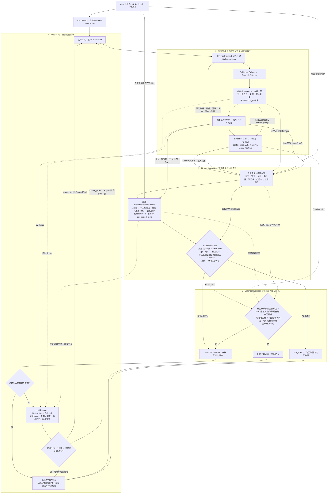

# OpsPilot

OpsPilot 是面向微服务的可恢复 RCA 系统。LLM 规划下一步调查，确定性代码从工具观测生成 Evidence、排序候选，并判断 `CONFIRMED / NO_FAULT / INCONCLUSIVE`。独立 Worker 通过 PostgreSQL、Redis 和 Checkpoint 执行、恢复任务。

当前代码说明更新于 **2026-10-12**。项目使用 Mock 或 OpenTelemetry Astronomy Shop 数据源，尚未验证企业生产环境；工具只读，处置建议不自动执行。

## 调查与决策



图中实线表示主流程或数据流，虚线表示传入判断与规划的补充输入；Gate 阈值为默认配置。实际顺序是：首轮工具 → 分析累计结果 → 计算 Gate → 调用 `decide_diagnosis` 评估观测、更新需求、判断存在性及 Verdict → 结束或规划下一轮。每轮重新分析累计结果，不沿用上一轮的需求满足状态。

Collector 与 AnomalyDetector 生成支持 / 反驳根因的结构化 Evidence，Ranker 据此给出最多 3 个临时候选。**ToolResult 还必须直接进入观测质量判断**：Evidence 主要承载因果线索，无法单独说明工具失败、成功但无数据、健康参考不足或服务 / 时间范围是否有效；没有 Evidence 也不能推导无故障。质量判断结合原始观测与 Evidence，重新统计具有有效异常支持的来源，要求其数量覆盖 Gate 计入的来源数。

动态需求先由 Alert 建立存在性信号（含活动量），再为非 `no_fault` Top1 及与它分差小于 0.15 的 Top2 增加可映射的机制区分信号；同一信号已是存在性需求时不重复添加。实际观测更新需求的满足状态、质量与建议工具。异常可满足需求；存在性需求的正常观测还必须有有效健康参考，测量冲突使相应需求不满足。未满足需求传给 Planner，建议工具仍受动作授权和预算约束。

Coordinator 只选择低成本首轮工具；之后复用 ToolRegistry 与现有 DB、Redis、Kafka、RPC Expert。领域工具不能由 Planner 直接 `inspect_tool`，必须通过相应 Expert。`INCONCLUSIVE` 是本轮判定；只有轮数与工具预算都剩余，且 Planner 返回合法、不重复、预算允许的动作时才继续。Expert 预算耗尽仅禁用 Expert 动作；否则保留未确认候选与停止原因结束。

Fault Presence 独立于排名：同一工具 / 信号 / 服务的正常与异常测量冲突时优先为 `UNKNOWN`；否则有与告警相关的有效异常为 `PRESENT`；再否则存在性需求全部健康覆盖为 `ABSENT`；其余为 `UNKNOWN`。缺失或失败不会抹去其他有效观测证明的异常。反驳 Top1 的证据会阻止根因确认，但不会单独抹去故障存在性。服务关联、时间窗、数据库调用群组和日志上下文限制证据范围。

| Verdict | 判定 |
| --- | --- |
| `CONFIRMED` | `PRESENT`，Gate 通过，Top1 有有效异常支持且覆盖 Gate 计入的来源数，无范围外支持，区分需求满足且可映射的 Top1 机制有异常观测，无未解决矛盾 |
| `NO_FAULT` | 未确认根因且 Fault Presence 为 `ABSENT`；不要求 Gate 通过，也不要求 Top1 排为 `no_fault` |
| `INCONCLUSIVE` | 其余情况，包括缺失关键观测及故障存在但根因未确认；预算耗尽也不会将它变为确认 |

**Top1 排名、Gate 通过、工具成功和预算耗尽，都不能单独替代最终确认。** 空 Evidence 或空查询结果不代表正常。异步业务完成度也不能由请求延迟正常代替。

LLM 只能返回 `inspect_tool` 或 `invoke_expert`，不决定 Verdict、不改变排名，也不读取工具后端快照 `alert.signals`。LLM 关闭或失败时，Fallback 优先测量已由 Evidence 支持的领域，再处理未满足的证据需求，最后补查未使用的通用工具。所有动作受白名单、去重和预算约束。

默认上限为 **4 轮 / 8 次工具 / 2 次 Expert**。Gate 默认检查 confidence ≥ 0.8、Top1/Top2 margin ≥ 0.15、独立来源 ≥ 2，且 Top1 不是 `no_fault`；同一 ToolResult 的多个证据只算一个独立来源。这些是可配置的根因可信度条件。

## Runtime、API 与报告

PostgreSQL 保存 Run、Step、ToolExecution、Checkpoint、事件和报告；Redis 只传递 `run_id`。API 快速接收请求，独立 Worker 执行调查。持久化 `request_id` 与稳定 `tool_call_id` 支持幂等，stale Run 可重新入队，恢复时复用已成功工具并重新判断观测。

| 方法 | 路径 | 用途 |
| --- | --- | --- |
| POST | `/api/v1/runs` | 提交 `request_id` 与 Alert |
| GET | `/api/v1/runs/{run_id}` | 查询 Run 状态 |
| GET | `/api/v1/runs/{run_id}/result` | 获取结果；运行中返回 202 |
| GET | `/api/v1/runs/{run_id}/events?after=0` | 增量事件，含工具状态、attempt、耗时和错误 |
| WS | `/api/v1/runs/{run_id}/stream` | 订阅调查事件 |

DiagnosisReport schema 为 **3.0**。`status=completed` 表示诊断执行完成，Run 的 `SUCCEEDED` 同样不保证根因已确认。报告还包含 `verdict`、`decision`、需求覆盖、Fault Presence、临时候选、Evidence 和嵌套调查轨迹。

`primary_root_cause` 为兼容保留的 Top1；只有 `primary_root_cause_confirmed=true` 和非空 `confirmed_root_cause` 表示已确认。`INCONCLUSIVE` 可以保留 Top-K。缺少新字段的历史报告按未确认读取。Checkpoint schema 也是 **3.0**，graph version 为 `opspilot-runtime-v6-compact-report`；兼容缺少新决策字段的调查状态，schema/graph 版本不匹配仍明确失败。

## 本地开发

要求 Python **3.11+**。从其他系统复制来的虚拟环境应备份，并在本机重新创建。

Windows PowerShell：

```powershell
py -3.12 -m venv .venv
.\.venv\Scripts\python.exe -m pip install -e '.[dev]'
.\.venv\Scripts\python.exe -m pytest -q
.\.venv\Scripts\python.exe -m ruff check src/opspilot tests/contract tests/integration tests/recovery scripts/otel_demo
```

上例使用本机已安装的 Python 3.12；其他符合要求的版本可替换创建命令。

Linux / macOS：

```bash
bash scripts/bootstrap_dev_env.sh
source .venv/bin/activate
python -m pytest -q
python -m ruff check src/opspilot tests/contract tests/integration tests/recovery scripts/otel_demo
```

默认本地 HTTP 测试使用测试应用、SQLite 和内存队列；未配置真实服务时部分集成测试跳过，不等于验证了实际 PostgreSQL/Redis 或 Demo 部署。

运行 API、Worker、PostgreSQL、Redis 与 Mock：

```bash
docker compose --profile full up --build -d
```

LLM 默认关闭。启用时配置 `OPSPILOT_LLM_ENABLED=true`、`DEEPSEEK_API_KEY`；模型、地址和超时由 `OPSPILOT_LLM_MODEL`、`OPSPILOT_LLM_BASE_URL`、`OPSPILOT_LLM_TIMEOUT_SECONDS` 控制。不要提交 `.env` 或密钥。API 请求及恢复验证见 [全流程指南](tests/guide/full-flow-test-guide.md)，本机说明见 [本地运行指南](docs/README_local.md)。

## OpenTelemetry 与验证现状

`OPSPILOT_OBSERVATION_BACKEND=otel_demo` 接入 Prometheus、Jaeger 和 OpenSearch；默认后端为 Mock。Astronomy Shop 使用固定 Demo 3.1.0 与 Collector 0.160.0，部署版本与脚本见 [集成指南](integrations/opentelemetry_demo/README.md)。已有 Windows Docker Desktop 部署、28 服务与 live smoke 验收记录；这些是当次验证结果，不表示当前机器上的容器仍运行。

真实 Benchmark 使用 Locust、六类故障加 Normal、3 repeats、3 modes，Ground Truth 与在线调查隔离。场景、配置及命令见 [Benchmark 指南](benchmarks/datasets/otel_demo/v1/README.md)。

| 验证记录 | 结果与范围 |
| --- | --- |
| [最近完整真实发布](reports/top1_18_iteration1.md)，2026-10-09 | 21 个恢复通过的生命周期、63 次诊断；Full 故障 Top1 **16/18**、Normal **3/3**，未达到 18/18 目标；该发布早于三终态改动 |
| [后续冻结实验](reports/top1_18_interrupted.md) | 60 次诊断，最后恢复查询失败，中断且未完成验收；Full 部分故障 Top1 **14/17**，不能当作完整发布 |
| [三终态验收](reports/task_10.9.md)，2026-10-10 合入 | 126 次既有真实工件离线回放；保留原排名，最新一批 Full 确认 **3/21**、拒判 **18/21**、错误确认 **0/21**；没有使用新实现重跑真实生命周期 |

三终态合入后的针对性回归 **68 passed**、Ruff 通过，这是 2026-10-10 的记录，不是当前全量测试数。回放中 Normal 工件缺少充分健康参考，未宣称 `NO_FAULT`；有效健康参考下的路径由针对性测试验证。零错误确认伴随较高拒判率，不能宣传为 100% 准确率。

旧 v1 Mock 数据集与 6/21 调查覆盖率记录保留供追溯，未修复或包装为当前验证；旧三路 LLM 消融与 snapshot latency 也不能代表新调查循环或生产效果。未接入 EvalRAG/Knowledge Tool，未实现生产自动修复或生产准确率保证。本次文档更新没有启动新实验。

## 文档与代码导航

- [架构与恢复边界](docs/architecture.md) · [工具说明](docs/tools_intro.md) · [数据流](docs/RCA_DATAFLOW_REFERENCE.md)
- [项目定位](docs/project_brief.md) · [项目材料](docs/project_materials.md) · [当前任务状态](docs/task_board.md)
- [验证与维护计划](docs/plan.md) · [历史规划索引](docs/history/20261012/README.md)

核心入口：`src/opspilot/investigation/{engine,analysis,decision,planner,report}.py`。`agents` 提供 Seed Coordinator 与 Ranker，`tools/evidence/rca/observations/tracing` 负责观测与分析，`api/runtime/persistence` 负责持久执行，`evaluation/otel_benchmark` 负责评测。`src/deeprca/mock_env` 保留独立 Mock 服务；旧诊断链已移除。`plan/`、`prds/` 和历史报告记录需求与演进，不代表全部当前实现。
