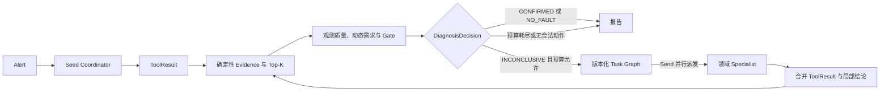
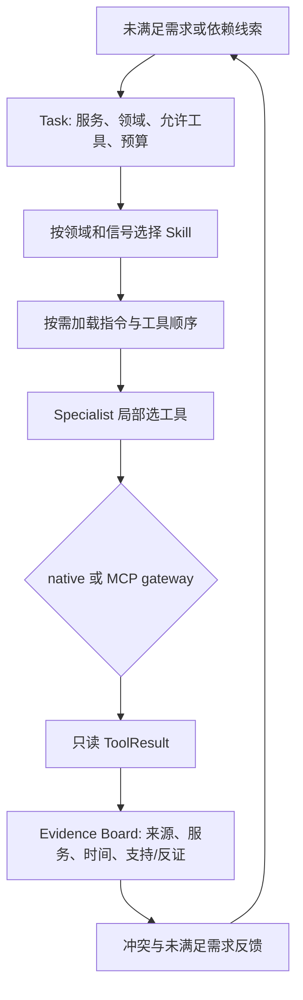

# OpsPilot V2 架构

V2 是可显式启用的调查路径（`OPSPILOT_INVESTIGATION_MODE=v2`）。现有 V1 仍是默认值，以便既有 Run 和历史评测继续使用原图与 Checkpoint。API、三终态和只读工具边界保持一致。

`GraphInvestigator` 在 `investigation/v2_graph.py` 构造真实 LangGraph：`seed → analyze → Send(specialist) → merge → analyze`。`analyze` 重新生成 Evidence、Top-K、需求、Gate 和 Decision；`reconcile_plan` 让观测改变任务状态和优先级。多个 Specialist 可同时读取各自的任务上下文，`merge` 按 Task ID 稳定合并。决策由现有确定性 `prepare_decision`、`EvidenceGate` 和 `decide_diagnosis` 完成，Agent 不能直接确认根因。

Skill catalog 先读元数据，激活时才读正文；Skill 只能调整授权工具的顺序。Specialist 的结构化 LLM 决策经 schema 和白名单校验，失败时使用确定性选择。MCP 模式使用官方 SDK 的进程内 Server/Client，实际执行 `list_tools` 与 `call_tool`；目前仅通用观测工具经 MCP，领域工具继续走原生 Registry。它不提供远程进程隔离或认证。所有后端调用仍由原 ToolRegistry 授权。

Evidence Board 持久化 Evidence ID、ToolCall ID、Task/Agent、目标服务、时间、来源、支持和反证以及观测质量；冲突和未满足需求也随图状态保存。Collector / AnomalyDetector 和原有 Ranker 仍是唯一证据与候选计算入口。ToolResult 同时进入观测质量判断，避免工具失败或空数据被误当成健康。

## 恢复与边界

PostgreSQL 是 Run、Checkpoint、事件、ToolExecution 和报告的持久化真相；Redis Streams 仅分发 Run ID。Worker 的租约与运行轮次防止旧 Worker 覆盖新轮次。V2 每次工具完成及分析节点后通过原 Checkpoint 通道保存状态；恢复时读取 V2 状态，再由已持久化的 ToolCall 结果复用成功调用。Checkpoint schema 为 `4.0`，graph version 为 `opspilot-runtime-v7-v2-graph`；V1 分别为 `3.0` 与 `opspilot-runtime-v6-compact-report`。旧版运行中的 Run 应先由 V1 Worker 排空，再切换 Worker 配置。版本不匹配会明确失败，不会静默转换。

轮数、工具数、Expert 数、并发任务数、运行时间和 LLM token 上限均可配置。并行派发预留工具和 token 预算；时间检查发生于派发和工具选择边界。token 上限基于本地估算与服务端返回用量，属于受控预算，不能保证远端计费绝对不越界。Worker 崩溃后计算可能重做；已成功持久化的 ToolCall 可复用，不宣称 Exactly-Once。

选择 LangGraph 是为了显式条件分支和并行汇合；PG 仍承载跨进程持久化，不另建竞争性图 Checkpointer。选择进程内 MCP 是为了验证标准发现/调用协议而不引入新基础设施；生产远程 MCP 的身份认证与隔离尚未实现。
