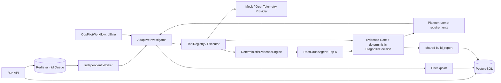

# OpsPilot 当前架构

更新：2026-10-12。本文描述已合入代码；旧迁移设计保存在 [历史记录](history/20261012/architecture.md)。

## 在线与离线路径

`api/app.py` 只接收请求和提供查询；`runtime/execution.py` 注入工具执行与状态回调。`graph/workflow.py` 是离线包装，不是另一个六节点 LangGraph，也不维护另一套诊断规则。在线与离线都使用 `investigation/report.py`。

## 模块契约

| 模块 | 实际职责 |
| --- | --- |
| `agents/coordinator.py` | 按公开告警信息选择最多 3 个通用 Seed Tool |
| `tools/registry.py`、`executor.py` | 13 个只读工具，输入输出验证、超时、有限重试、执行记录 |
| `observations/provider.py`、`clients.py` | Mock 或 Prometheus/Jaeger/OpenSearch 适配 |
| `investigation/analysis.py` | 累计 ToolResult → collector + AnomalyDetector → 去重 Evidence → Ranker |
| `investigation/planner.py` | LLM/Fallback、动作授权、现有 Evidence Gate；不输出 finalize |
| `investigation/decision.py` | 观测质量与服务/时间范围、动态需求、存在性和最终三终态 |
| `investigation/engine.py` | 执行多轮调查、预算、去重、决策历史和恢复状态 |
| `agents/root_cause.py` | Evidence 支持/反驳驱动的确定性排名；可选解释不改排名 |
| `runtime`、`persistence` | Run 状态机、独立 Worker、队列、持久化、恢复与幂等 |
| `evaluation`、`otel_benchmark` | Mock 评测与真实 Demo 故障生命周期、标签隔离和工件 |

算法在每轮 Ranking 前运行，最终 Report 不再另跑一套分析。当前算法是历史基线、IQR 和滚动波动；旧 NoiseFilter/ExpertRuleEngine/L1 Finding promotion 架构不能视为当前在线实现。

## 排名、存在性和确认

排名只表示候选优先级。`decide_diagnosis` 从真实观测判断 Fault Presence，评估需求覆盖和矛盾；Gate 通过后仍需机制、来源与范围校验。`CONFIRMED` 或 `NO_FAULT` 才可信停止；预算耗尽、无合法动作等以 `INCONCLUSIVE` 结束，保留临时 Top-K。

动态需求包含告警存在性和近邻候选机制区分；成功无数据、失败、缺基线、正常、异常、范围外和矛盾分别记录。明确的告警阈值按支持的单位归一化；未知单位不能直接套用。健康参考缺失时不能从空 Evidence 推断正常。

## 持久化与兼容

PostgreSQL 为事实源；Redis 仅传递 run_id。Worker 在调查 Action、Tool 和 Gate 边界持久化状态，保存决策历史。恢复后复用成功 ToolCall，并基于观测重新判断；Run `SUCCEEDED` 表示执行成功，不保证 Verdict 为 `CONFIRMED`。

DiagnosisReport schema 3.0；Checkpoint schema 3.0、graph version `opspilot-runtime-v6-compact-report`。历史报告缺少新字段时按未确认读取；相同版本调查状态可缺少新决策字段，版本不匹配仍拒绝。工具执行细节通过事件 API 获取。

API、预算、默认阈值及实测范围统一见 [README](../README.md)。原始生产数据、自动修复、知识检索和新三终态实时故障生命周期验证未实现或未验收。
