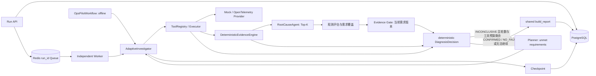

# OpsPilot 当前架构

更新：2026-10-17。本文描述已合入代码；旧迁移设计保存在 [历史记录](history/20261012/architecture.md)。

## 在线与离线路径

`api/app.py` 只接收请求和提供查询；`runtime/execution.py` 注入工具执行与状态回调。`graph/workflow.py` 是离线包装，不是另一个六节点 LangGraph，也不维护另一套诊断规则。在线与离线都使用 `investigation/report.py`。

## 模块契约

| 模块 | 实际职责 |
| --- | --- |
| `agents/coordinator.py` | 按公开告警信息选择最多 3 个通用 Seed Tool |
| `tools/registry.py`、`executor.py` | 13 个只读工具，输入输出验证、超时、有限重试、执行记录 |
| `observations/provider.py`、`clients.py` | Mock 或 Prometheus/Jaeger/OpenSearch 适配 |
| `investigation/analysis.py` | 累计 ToolResult → collector + AnomalyDetector → 去重 Evidence → Ranker |
| `investigation/planner.py` | LLM/Fallback、动作授权、现有 Evidence Gate；不输出 finalize |
| `investigation/decision.py` | 观测质量与服务/时间范围、动态需求、存在性和最终三终态 |
| `investigation/engine.py` | 执行多轮调查、预算、去重、决策历史和恢复状态 |
| `agents/root_cause.py` | Evidence 支持/反驳驱动的确定性排名；可选解释不改排名 |
| `runtime`、`persistence` | Run 状态机、独立 Worker、队列、持久化、恢复与幂等 |
| `evaluation`、`otel_benchmark` | Mock 评测与真实 Demo 故障生命周期、标签隔离和工件 |

算法在每轮 Ranking 前运行，最终 Report 不再另跑一套分析。当前算法是历史基线、IQR 和滚动波动；旧 NoiseFilter/ExpertRuleEngine/L1 Finding promotion 架构不能视为当前在线实现。

## 调查与决策的数据流

完整子图和条件分支见 [README「调查与决策」](../README.md#调查与决策)。下面按实际执行顺序解释输入、输出和判断边界；图中的动态需求由 `prepare_decision` 在 Gate 前计算，Fault Presence 由 `decide_diagnosis` 计算，不是另外的 LLM Agent。

源码对应：[分析入口](../src/opspilot/investigation/analysis.py)、[决策与动态需求](../src/opspilot/investigation/decision.py)、[调查引擎](../src/opspilot/investigation/engine.py)、[Planner / Gate / 动作授权](../src/opspilot/investigation/planner.py)、[确定性 Ranker](../src/opspilot/agents/root_cause.py)。

### 1. 累计观测生成 Evidence，再排名

`AdaptiveInvestigator.run` 先执行 Coordinator 选择的 General Seed Tools；恢复时复用已执行工具，并续执行已规划但未完成的动作。随后每轮 `_analyze` 都将 **Alert 与累计 ToolResult** 传给 `DeterministicEvidenceEngine.analyze`：

1. `collect_evidence` 从工具观测提取机制、指标、日志、调用及变更线索；`AnomalyDetector.detect` 补充历史基线、IQR、滚动波动等异常证据。
2. 合并后按 `evidence_id` 去重，以置信度和 ID 排序。Evidence 保留 `supports / contradicts`、`confidence`、服务、`source_group` 与 `raw_ref`，可追溯到原始工具结果。
   `contradicts` 保留已有显式证据的兼容处理；Collector 和 AnomalyDetector 不会仅凭正常测量自动生成根因反证。
3. `RootCauseAgent.diagnose` 根据支持与反驳进行确定性排名，返回最多 3 个候选。直接机制证据权重更高，模糊支持在候选间分摊；同类来源重复证据取最大贡献，独立来源补充有限贡献。没有正分候选时返回兼容候选 `no_fault`，这仍不能证明 Fault Presence 为 `ABSENT`。

Evidence 是面向候选的因果表达，不是完整观测覆盖账本。工具失败、查询成功但无数据、缺少有效健康参考、数据属于其他服务或时间窗等情况，可能没有对应的支持 Evidence。因此决策必须同时读取 **原始 ToolResult + Evidence + Alert + Top-K**，不能只看 Evidence 或 Top1。

### 2. 先评估观测与动态需求，再计算 Gate

`engine.py` 在分析后先用 `prepare_decision` 评估累计观测、增量更新需求及覆盖状态，再计算预算，并调用 `EvidenceGate.evaluate(candidates, evidence, budget_exhausted=..., requirements=..., requirements_version=...)`。Gate 评价当前排名的可信度与必要需求覆盖，默认要求同时满足：

- Top1 不是 `no_fault`，且 confidence ≥ 0.8。
- Top1 与 Top2 的 confidence 分差 ≥ 0.15；没有 Top2 时其置信度按 0 计算。
- Top1 引用且明确支持它的 Evidence 至少有 2 个不同的非空 `source_group`。同一 ToolResult 产生的多个 Evidence 不增加来源数。
- 当前阻断确认的需求均已满足；GateDecision 保存 `requirements_version` 与未满足项，最终确认还校验版本一致。

`budget_exhausted` 是 GateDecision 的执行状态与原因输入，不会把不充分证据变成充分证据。Gate 阈值可配置；下述近邻候选需求的分差 **0.15 是 `decision.py` 当前固定条件**，不要将两者视为同一个可配置参数。

接着将同一轮的预备结果和 GateDecision 传入 `decide_diagnosis`。`prepare_decision` 先通过 `assess_observations` 生成 ObservationAssessment：

- 从告警服务与告警附近的 Trace 父子调用建立关联服务范围，按工具和观测类型检查数据与因果证据。时间校验在支持的指标时间点、Span、日志等路径执行，当前 incident-local 判断为告警时间前后 60 秒，并非所有工具都具有相同的原始时间字段。
- 区分 `NORMAL / ABNORMAL / NO_DATA / FAILED / MISSING_BASELINE / UNSCOPED`，保留观测 ID、信号、服务、健康参考状态与关联 Evidence ID。明确告警阈值按代码支持的单位归一化；无法比较的阈值不能当作有效绝对判据。
- 仅当 `(tool_name, signal, service)` 相同，且指标定义、单位、统计口径相同、显式时间窗口重叠时，正常与异常才记录测量冲突；作用于范围内服务且反驳 Top1 的 Evidence 另记候选矛盾。不同测量群体的健康与异常不会自动互相抵消，例如下游调用健康不反驳入口错误率异常。

然后每轮根据新观测更新需求，旧满足状态不会直接沿用；未解决的观测触发需求保留到明确证实不再相关：

| 需求来源 | 当前规则 | 满足条件与输出 |
| --- | --- | --- |
| Alert → `existence` | `initial_signals` 根据告警类型、描述、标签及已有观测确定存在性信号，并要求活动量；涉及异步完成 / 队列的 Custom 告警另需 completion | 有有效异常，或有带有效健康参考的正常观测；冲突时不满足 |
| Top-K → `root discrimination` | Top1 非 `no_fault` 时，检查前两个候选：Top1 必选，Top2 仅在分差小于 0.15 时考虑；机制经 `CAUSE_SIGNALS` 映射且须在 `SIGNAL_TOOLS` 中。按服务、依赖、信号及用途去重 | 有有效异常或正常观测，且无测量冲突；正常机制测量可区分或削弱假设，但不能单独确认根因 |
| 相关观测 → 机制验证 | 告警范围内失败或缓慢的下游调用、异步消息链路触发目标明确的 RPC / DB / Kafka 需求；普通依赖或无关异常不触发 | 已有同目标有效观测可满足；无能力的信号保留缺失状态，不伪称已测；触发消失且机制已检查后显式关闭 |
| 实际观测 → 需求覆盖 | 每个信号关联该轮累计观测，重新生成 `satisfied / quality / observation_ids / reason` | 无观测为 `NO_DATA`；冲突需求为 `CONFLICT`，并附 `suggested_tools` |

需求满足不等于故障确认：异常和充分正常观测都可以满足需求，但支持不同结论。`SIGNAL_TOOLS` 只是建议测量工具的映射，不授予 Planner 直接执行领域工具的权限。所有需求及版本都随 DiagnosisDecision 保存；引擎仅在 `INCONCLUSIVE` 且预算允许时把未满足项传入 Planner。

### 3. Fault Presence 与最终三终态

存在性判断只依赖有效观测及存在性需求，不以 Top1 排名或 Gate 为依据。`decision.py` 按以下优先级生成 Fault Presence：

1. 存在测量冲突 → `UNKNOWN`。
2. 否则有与告警存在性信号相关的异常（活动量本身不作此类故障证明）→ `PRESENT`。Custom 告警可由更广泛机制异常证明存在性，但单纯 `bad_deployment` 不足以证明故障。
3. 否则存在性需求非空、全部满足且质量均为健康正常 → `ABSENT`。
4. 其余 → `UNKNOWN`。

故障存在和根因确认是两层判断。缺失或失败不自动否定其他有效观测已经证明的异常；反驳 Top1 的证据也不单独将 `PRESENT` 改成 `UNKNOWN`，但会阻止根因确认。

在 Fault Presence 计算后，代码校验 Top1 的异常支持、来源、范围和机制，再按 **CONFIRMED → NO_FAULT → INCONCLUSIVE** 的顺序确定 Verdict：

| Verdict | 必须满足的条件 |
| --- | --- |
| `CONFIRMED` | Presence 为 `PRESENT`；Gate sufficient；Top1 不是 `no_fault` 且其 Evidence 与有效异常观测的 Evidence ID 有交集；支持 Top1 的已验证来源数至少覆盖 Gate 计入的来源数；候选未引用被标为 `UNSCOPED` 的 Evidence；当前阻断确认的需求满足，且可映射的 Top1 机制另有异常观测；没有测量冲突或范围内反驳 Top1 的矛盾 |
| `NO_FAULT` | 未满足确认条件，且 Presence 为 `ABSENT`。不要求 Gate 通过，也不要求排名第一为 `no_fault`；结论仅适用于当前告警范围与窗口 |
| `INCONCLUSIVE` | 其余情况，包括存在性未知，或故障存在但根因的来源、范围、机制、区分条件或 Gate 不充分 |

确认条件没有要求所有存在性需求一律满足：已验证的相关异常可以证明 `PRESENT`，确认仍以 Gate、根因有效支持及机制等条件为准。相反，`ABSENT` 需要存在性需求全部健康覆盖，空 Evidence、空查询结果或工具调用成功均不足以产生 `NO_FAULT`。

DiagnosisDecision 输出 `verdict / fault_presence / root_cause_confirmed / reason`，同时保留 requirements、observations 和 contradictions。预算耗尽只能补充停止原因，不改变以上真值条件。

### 4. INCONCLUSIVE 如何继续或结束

`engine.py` 保存每轮 GateDecision 和 DiagnosisDecision 后判断是否继续：

1. `CONFIRMED / NO_FAULT` 立即结束；即使此时预算已耗尽，也保留已经满足条件的确定性结论。
2. `INCONCLUSIVE` 且达到轮数上限 **或** 工具上限时结束，保留未确认候选。Expert 次数上限不在 `_budget_exhausted` 的整轮停止条件中。
3. 否则 Planner 接收公开 Alert、Evidence、Top-K、未满足需求、动作历史 / 身份、已执行工具 / Expert 和三类剩余预算。LLM 输入对 Evidence 去重并限制为 20 条，Top-K 最多 3 条；它选择测量动作，不输出 Verdict。
4. LLM 关闭、失败或返回非法 / 重复 / 不可用动作时使用确定性 Fallback：优先观测触发的必要机制需求，再尝试已有 Evidence 支持且未调用的领域与其他未满足需求建议工具，最后选择未执行的通用工具。领域工具建议转换成相应 Expert 调用。
5. 无合法动作时结束；引擎还会检查动作去重、授权和 Expert 预算。取得动作后推进一轮：`inspect_tool` 仅执行 General Tool；`invoke_expert` 调用未使用的 DB / Redis / Kafka / RPC Expert，由它根据已有 Evidence 选择领域工具，受工具总预算限制，并跳过已执行工具。
6. 新 ToolResult 追加到累计结果，再进入 **Collector / AnomalyDetector → Evidence → Ranker → 观测与需求覆盖 → Gate → decide_diagnosis**，重新生成覆盖与结论。

默认总预算是 4 轮 / 8 次工具 / 2 次 Expert。Expert 预算为零时仍可选择剩余通用工具；工具失败也保留 ToolResult 并计入已执行工具数，闭环不是无限重试。正常 Planner 路径对非法 LLM 动作进行 Fallback；绕过该约束的自定义 Planner 若违反 ActionValidator，会抛出执行错误，不应把它描绘成正常的 `INCONCLUSIVE` 停止分支。

结束时 `investigation/report.py` 使用已有 Evidence 与候选构建报告，不再运行 Collector 或 Ranker；它会以实际 ToolResult 重算当前需求版本并校验最后的 GateDecision，再执行 `decide_diagnosis`，避免信任恢复元数据中的结论。`INCONCLUSIVE` 保留临时 Top-K、需求覆盖、决策轨迹与停止原因，不升级为已确认根因。

## 持久化与兼容

PostgreSQL 为事实源；Redis 仅传递 run_id。Worker 在调查 Action、Tool 和 Gate 边界持久化状态，保存决策历史。恢复后复用成功 ToolCall，并基于观测重新判断；Run `SUCCEEDED` 表示执行成功，不保证 Verdict 为 `CONFIRMED`。

DiagnosisReport schema 3.0；Checkpoint schema 3.0、graph version `opspilot-runtime-v6-compact-report`。历史报告缺少新字段时按未确认读取；相同版本调查状态可缺少新决策字段，版本不匹配仍拒绝。工具执行细节通过事件 API 获取。

API、预算、默认阈值及实测范围统一见 [README](../README.md)。原始生产数据、自动修复、知识检索和新三终态实时故障生命周期验证未实现或未验收。
