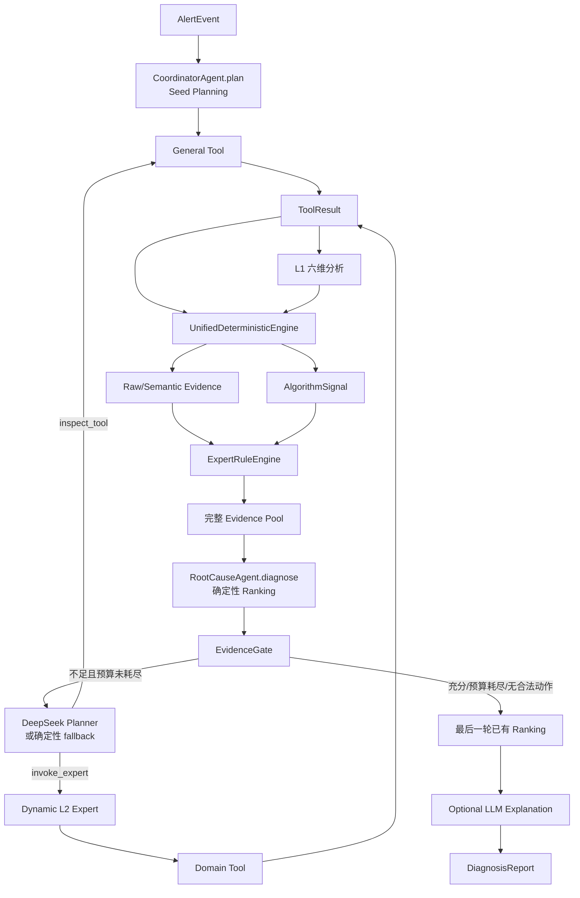
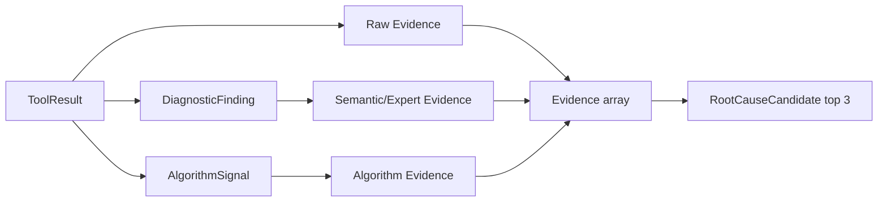
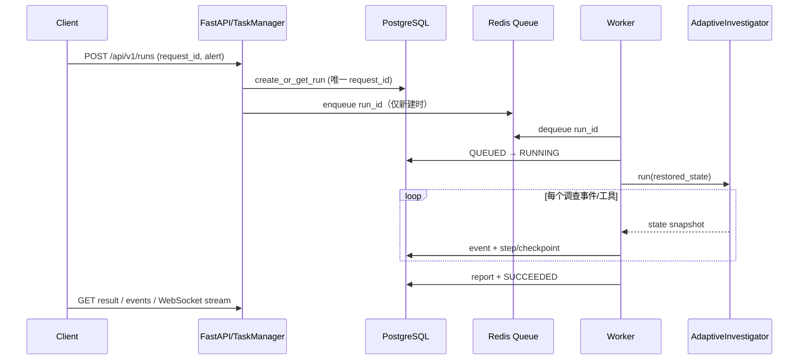
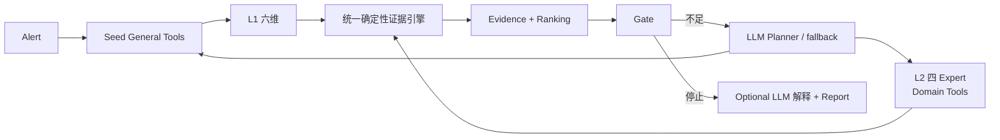

# OpsPilot RCA 源码说明书

> 基线：当前仓库 `opspilot-runtime-v4-unified-evidence` / `adaptive-v2`。本文只描述源码实际行为；“设计意图”和“当前实现偏差”会单独标注。核心模型见 `src/opspilot/models/schemas.py`。

## 1. 唯一主数据流



| 环节 | 执行频率 | 真实时点与职责 | 源码 |
|---|---:|---|---|
| Seed Planning | 每个新调查 1 次 | 根据告警生成最多 3 个 General Tool；恢复时不会重新规划已保存动作 | `src/opspilot/agents/coordinator.py: CoordinatorAgent.plan`；`src/opspilot/investigation/engine.py: AdaptiveInvestigator.run` |
| Tool 执行 | Seed 一批，之后每个动作按需 | 结果累计进 `tool_results`，不覆盖旧结果 | `investigation/engine.py`；`tools/executor.py: ToolExecutor.execute` |
| Unified deterministic analysis | Seed 完成后 1 次；以后每个有效动作后 1 次 | 每次都基于累计 ToolResult 重算 L1、L2、算法、规则、Evidence 和候选 | `investigation/analysis.py: UnifiedDeterministicEngine.analyze` |
| Ranking | 每次 unified analysis 内 1 次 | provisional 与 final 都来自 `RootCauseAgent.diagnose`；最终阶段不另换算法、不让 LLM 重排 | `investigation/analysis.py`；`agents/root_cause.py` |
| Gate | 每次 Ranking 之后 | 先判断证据充分，再判断预算；不足且有预算才进入 Planner | `investigation/engine.py: _evaluate_gate` |
| Adaptive Planner | 非 Seed；仅 Gate 不足且预算未耗尽时 | `llm_enabled=true` 时尝试 DeepSeek；失败或关闭时走 deterministic fallback | `investigation/planner.py: AdaptivePlanner.next_action` |
| LLM Explanation | 调查结束后最多 1 次 | 只解释已有候选和 Evidence；不改 Evidence、score 或排序 | `agents/root_cause.py: explain_existing`；`runtime/execution.py` |
| Report | 1 次 | 组装最后一次分析结果、调查轨迹、工具执行与说明 | `runtime/execution.py: RecoverableExecution.execute` |

“provisional”只是调查尚未停止时的候选快照；“final”是最后一次相同 deterministic pipeline 的快照。二者没有两套决策算法。

## 2. Coordinator / Seed Planner

### 2.1 默认 Seed 映射

| `alert_type` | 默认 Seed Tools（有序） | 对应 L1 dimension |
|---|---|---|
| `timeout` | `metrics.query`, `traces.query`, `changes.query` | `upstream`, `downstream`, `change` |
| `error_rate` | `metrics.query`, `logs.query`, `traces.query` | `upstream`, `errorlog`, `downstream` |
| `resource` | `metrics.query`, `logs.query` | `cluster`, `errorlog` |
| `custom` | `metrics.query`, `logs.query`, `changes.query` | `cluster`, `errorlog`, `change` |

动态 `_analysis_plan` 还会把之后执行的 General Tool 映射为：`metrics.query → upstream`（timeout/error_rate）或 `cluster`（resource/custom）、`logs.query → errorlog`、`changes.query → change`、`traces.query → downstream`、`topology.query → upstream`、`alerts.query → problem`。同维度的工具会合并到同一个 `DimensionTask.tools`。源码：`src/opspilot/agents/coordinator.py: SEED_TOOLS, dimension_for_tool, CoordinatorAgent.plan`；`src/opspilot/investigation/engine.py: _analysis_plan`。

### 2.2 severity / labels 修改

| 条件 | 修改规则 |
|---|---|
| `severity == P0` | 若尚无 `logs.query`，插入索引 1 |
| label key/value 文本含 `deploy/release/version/config` | `changes.query` 移到最前 |
| label key/value 文本含 `dependency/downstream/trace/rpc` | `traces.query` 移到最前 |
| 最后处理 | 去重，仅保留 General Tool，并截断为前 3 个 |

Seed Planner 只能调用 `registry.general_names()`。Domain Tool 必须经过 `invoke_expert`，由 Expert 再选；这是权限边界而不是推荐约定。源码：`agents/coordinator.py`、`investigation/planner.py: ActionValidator.validate`。

## 3. Tool 完整清单

所有成功结果均为 `ToolResult.data = {"observations": ...}`。当 `alert.signals` 非空时，它被视为完整 snapshot：缺失 signal 返回 `{}`，不会回退 HTTP。源码：`tools/registry.py: ObservationProvider.fetch`。

### 3.1 General Tools
signal_key：工具去哪里取数据，相当于数据分类名。  
observations：工具最终返回给分析模块的数据字段。

两种表头的区别：
- “observations 主要字段”：General Tool 通常返回该分类下的大部分原始信息，所以列出主要字段。  
- “observations 过滤字段”：Domain Tool 只返回专家需要的字段，相当于从完整数据中筛选一部分。  

| tool | domain | 调用者 | signal_key / observations 主要字段 | Mock HTTP 来源 | 主要消费者 |
|---|---|---|---|---|---|
| `metrics.query` | - | Seed / Planner | `metric`; `qps`, `error_rate`, `tp99/tp95`, `cpu_usage`, `memory_usage`, `disk_usage`，可含 `current/value/time_series/baseline_series/last_week/yesterday` | `/api/v1/mock/service/{service}/metrics/{qps,error_rate,tp99,cpu_usage,memory_usage}` | L1 upstream/cluster、raw collector、五类确定性算法 |
| `logs.query` | - | Seed / Planner | `log`; `logs` 或 `messages` | `/api/v1/mock/service/{service}/logs` | L1 errorlog、raw log Evidence、Rule |
| `changes.query` | - | Seed / Planner | `change`; `recent_deployment`, `changes`, `high_risk_count` | `/api/v1/mock/service/{service}/changes` | L1 change、raw change Evidence、Rule |
| `traces.query` | - | Seed / Planner | `trace`; `traces/spans` 或聚合 `timeout_rate/error_rate/latency_ms/baseline_latency_ms` | `/api/v1/mock/service/{service}/traces` | L1 downstream Span Tree、raw RPC-like Evidence |
| `topology.query` | - | Planner | `topology`; provider 原样返回 | `/api/v1/mock/service/{service}/topology` | L1 upstream 的上下文输入；当前不产 Finding/Evidence |
| `alerts.query` | - | Planner | `problem`; `related_alerts/alerts`, `known_issues` | `/api/v1/mock/service/{service}/alerts` | L1 problem；当前无 raw converter |

### 3.2 Domain Tools

| tool | expert | 调用者 | signal_key / observations 过滤字段 | Mock HTTP 来源 | 主要消费者 |
|---|---|---|---|---|---|
| `db.replication` | DB | DB Expert | `db`; `replication_lag_seconds`, `slave_delay_seconds` | `/api/v1/mock/db/mysql-prod-01/metrics` | DB L2、raw DB collector |
| `db.slowlog` | DB | DB Expert | `db`; `slow_query_count`, `slow_queries` | 同上 | DB L2、raw DB collector |
| `db.connections` | DB | DB Expert | `db`; `active_connections`, `max_connections` | 同上 | DB L2、raw DB collector |
| `redis.memory` | Redis | Redis Expert | `redis`; `memory_usage_percent`, `used_memory`, `evicted_keys` | `/api/v1/mock/redis/redis-cluster-01/metrics` | Redis L2、raw collector |
| `redis.hotkeys` | Redis | Redis Expert | `redis`; `hit_rate_percent`, `hit_rate`, `hotkeys` | 同上 | Redis L2、raw collector |
| `kafka.lag` | Kafka | Kafka Expert | `kafka`; `consumer_lag`, `total_lag`, `produce_rate`, `consume_rate` | `/api/v1/mock/kafka/kafka-prod-01/metrics` | Kafka L2、raw collector |
| `rpc.metrics` | RPC | RPC Expert | `rpc`; `timeout_rate`, `error_rate`, `latency_ms`, `baseline_latency_ms`, `call_volume` | service metrics 多端点后派生 | RPC L2、raw collector |

### 3.3 legacy compatibility Tools

| tool | kind | signal_key | 当前用途 |
|---|---|---|---|
| `db.inspect` | compatibility | `db` | 兼容旧 benchmark/调用代码；不在 General/Domain allow-list |
| `redis.inspect` | compatibility | `redis` | 同上 |
| `kafka.inspect` | compatibility | `kafka` | 同上 |
| `rpc.inspect` | compatibility | `rpc` | 同上 |

它们仍可被 registry/executor 直接执行，也能被 collector/L2 读取，但当前 Seed、Planner、Expert 都不会选择。注册与分类：`tools/registry.py: build_default_registry, ToolRegistry.general_names/domain_names`。

## 4. ToolResult → L1 Finding

源码：`agents/diagnostics.py: ChangeAgent, UpstreamAgent, DownstreamAgent, ClusterAgent, ErrorLogAgent, KnownProblemAgent`。

| 维度 | 输入 / 字段 | finding_type 与触发条件 | confidence / severity | 数量 | source_group |
|---|---|---|---|---:|---|
| change | `changes.query`: `recent_deployment`, `changes`, `high_risk_count` | 任一为真或 `high_risk_count >= 1` → `recent_change` | `.85` / warning | 0/1 | 对应 change ToolCall |
| upstream | `metrics.query`: `qps/upstream_qps` series | 至少 2 点、前段均值 > 0、末点 `< 0.5 × 前段均值` → `upstream_qps_drop` | `.8` / warning | 0..2 | metrics ToolCall |
| upstream | `metrics.query`: `error_rate/upstream_error_rate` series | `max(series) >= .05` → `upstream_error_rate` | `.8` / warning |  | metrics ToolCall |
| upstream | `topology.query` | 当前只被读取，不产生 Finding | - | 0 | - |
| downstream | `traces.query`: 标准化 child spans | 状态 `ERROR/FAILED/TIMEOUT/CANCELLED/ABORTED` → `downstream_span_error`；否则状态 `SLOW` 或 `duration_ms > 1000` → `downstream_span_slow` | `.9`; error critical，slow warning | 0..N | traces ToolCall |
| cluster | `metrics.query`: 当前 `cpu_usage/memory_usage` | 数值大于 1 先除 100；`>= .85` → `cpu_usage_high` / `memory_usage_high` | `.9`; `>=.95` critical，否则 warning | 0..2 | metrics ToolCall |
| errorlog | `logs.query`: `logs/messages` 文本 | 含 `OutOfMemory/OOMKilled` → `oom_signature`；否则非空 → `error_pattern` | `.95` critical；否则 `min(.5+n/100,.8)` warning | 0/1 | logs ToolCall |
| problem | `alerts.query`: `related_alerts/alerts`, `known_issues` | 两类条目总数 > 0 → `related_incident` | `min(.5+n*.1,.9)` / warning | 0/1 | alerts ToolCall |

所有 L1 Finding（包括不转 Evidence 的三种）都进入 Planner 的 `l1_findings` 上下文，也进入 ExpertRule 的文本上下文。Downstream 使用 `TraceNormalizer` 兼容 native/Jaeger/OTel，以 `span_id/parent_span_id` 重建根服务到异常 child span 的完整 path；若同一 span 又慢又错误，error 分支优先，只产生 error Finding。源码：`tracing/normalizer.py`。

`source_group` 形式为 `tool:<tool_name>:<tool_call_id>`；Finding 用 `source_groups: list[str]` 保存。`upstream` 中 topology 参与维度输入，但 Finding provenance 当前固定取 metrics 结果。

## 5. Dynamic L2 Expert

Planner 先选择 Expert domain；Expert 再选 Domain Tool。源码：`investigation/planner.py: AdaptivePlanner._deterministic_fallback`、`agents/diagnostics.py`。

| Expert | Planner 选择线索与默认顺序 | Tool 子集规则 | L2 Finding（阈值；confidence/severity） | Evidence |
|---|---|---|---|---|
| DB | 文本含 db/mysql/database/replica/slow query/connection/persistence 等；timeout 默认候选 `rpc→db`，resource 默认含 DB | replica/read/mysql → replication；slow/query/mysql/persistence → slowlog；connection/queue/capacity/resource/storage/waiting → connections；无命中：resource→connections，timeout→replication+slowlog，其余→slowlog | lag `>=5s` → `db_replication_lag` (`.9`; `>=15` critical)；slow count `>=10` → `db_slow_query` (`.85`, warning)；connection ratio `>=.8` → `db_connection_exhausted` (`.9`, warning) | `expert.<finding_type>`，并有对应 raw DB Evidence |
| Redis | redis/cache/memory/hit/hotkey 等；error_rate 默认列表含 Redis，resource 默认含 Redis | memory/capacity/resource→memory；hit/hotkey/fallback/backend load→hotkeys；无命中→memory | memory `>=80%` → `redis_memory_pressure` (`.9`, warning)；hit rate `<=90%` → `redis_low_hit_rate` (`.85`, warning) | 同型 expert Evidence + raw Redis Evidence |
| Kafka | kafka/broker/consumer/lag/rebalance/backlog/event 等；error_rate/resource/custom 的 fallback 顺序中可出现 | 固定 `kafka.lag` | lag `>=1000` → `kafka_consumer_lag` (`.9`, warning) | expert + raw Kafka Evidence |
| RPC | rpc/downstream/dependency/timeout/latency/error/circuit 等；timeout/error_rate 优先 | 固定 `rpc.metrics` | timeout rate `>=.05` 或 latency/baseline `>=3` → `rpc_timeout` (`.9`, warning)；error rate `>=.05` → `rpc_error_rate` (`.85`, warning) | expert + raw RPC Evidence |

同一 Expert 的 Domain Tool observations 会按执行顺序合并，后值覆盖前值。没有 Finding 时仍返回 `SemanticAnalysisResult(confidence=.1)`。

权限强制链：Planner 只输出 `inspect_tool` 或 `invoke_expert` → Pydantic schema 严格校验 → `ActionValidator` 对 `inspect_tool` 只接受 `general_names()`，对 `invoke_expert` 只接受四个 domain → Expert 的 `tools_for_context` 结果再次要求属于其 domain。Adaptive Planner 因而不能直接输出 `db.replication` 等 Domain Tool。

## 6. Finding → Evidence

### 6.1 L1 Semantic Evidence

| finding_type | evidence_type | supports | source_type/name | confidence / source_group |
|---|---|---|---|---|
| `recent_change` | `change.recent_change` | `bad_deployment` | rule / dimension name | Finding 原值；继承 Finding 首个 group |
| `upstream_error_rate` | `upstream.upstream_error_rate` | `rpc_error_rate` | rule / dimension name | 同上 |
| `downstream_span_error` | `downstream.downstream_span_error` | 默认 `rpc_error_rate`；路径含 DB/Redis/Kafka 关键字时改为相应 domain causes | trace / dimension name | 同上 |
| `downstream_span_slow` | `downstream.downstream_span_slow` | 默认 `rpc_timeout`；同样支持 dependency override | trace / dimension name | 同上 |
| `cpu_usage_high` | `cluster.cpu_usage_high` | `resource_saturation` | rule / dimension name | 同上 |
| `memory_usage_high` | `cluster.memory_usage_high` | `resource_saturation` | rule / dimension name | 同上 |
| `oom_signature` | `errorlog.oom_signature` | `oom_restart` | rule / dimension name | 同上 |

Dependency override：path/service 文本含 `mysql/postgres/database` 或子串 `db` 时支持三个 DB cause；含 `redis` 支持两个 Redis cause；含 `kafka/broker` 支持 Kafka cause。源码：`evidence/collector.py: collect_semantic`。

不转换：`upstream_qps_drop`、`error_pattern`、`related_incident`。它们仍在 `dimension_results`，输入 Planner 的 Finding 摘要，并进入 ExpertRuleEngine 的字符串 context；因此“没有直接 Evidence”不等于完全无作用。

### 6.2 L2 Expert Evidence

| finding_type | evidence_type | supports | source_type/name | confidence / source_group |
|---|---|---|---|---|
| DB 三类 | `expert.db_*` | 同名 DB RootCauseType | rule / Expert 结果名 | Finding 原值；继承对应 Domain Tool group |
| Redis 两类 | `expert.redis_*` | 同名 Redis RootCauseType | rule / Expert 结果名 | 同上 |
| `kafka_consumer_lag` | `expert.kafka_consumer_lag` | 同名 cause | rule / Kafka Expert | 同上 |
| `rpc_timeout/error_rate` | `expert.rpc_*` | 同名 cause | rule / RPC Expert | 同上 |

## 7. Raw ToolResult → Evidence

源码：`evidence/collector.py: EvidenceCollector.collect` 及 `_db/_redis/_kafka/_rpc/_metric/_log/_change`。

| Tool / converter | 触发条件 | evidence_type → supports | confidence / severity | source_group |
|---|---|---|---|---|
| DB compat 或三个 domain tools | lag `>=5` | `db.replication_lag` → DB lag | `min(.65+lag/100,.95)`；`>=15` critical | 该 ToolCall |
| DB | slow count `>=10` | `db.slow_query` → DB slow | `min(.65+count/200,.95)`；`>=50` critical | 同上 |
| DB | connections/max `>=.8` | `db.connection_usage` → DB connection | `.9`；`>=.95` critical | 同上 |
| Redis compat/domain | memory `>=80%` | `redis.memory_usage` → memory pressure | `.9`；`>=95` critical | 同上 |
| Redis | hit `<=90%` | `redis.hit_rate` → low hit **和** memory pressure | `.85`；`<70` critical | 同上 |
| Kafka compat/domain | lag `>=1000` | `kafka.consumer_lag` → Kafka lag | `min(.7+lag/100000,.95)`；`>=10000` critical | 同上 |
| RPC compat/domain、`traces.query` 聚合字段 | timeout `>=.05` 或 latency ratio `>=3` | `rpc.timeout` → RPC timeout | `.9`；timeout `>=.1` critical | 同上 |
| RPC / traces | error rate `>=.05` | `rpc.error_rate` → RPC error | `.85`；`>=.1` critical | 同上 |
| `metrics.query` | CPU/memory 当前值 `>=.85` | `metric.resource_saturation` → resource | `.9`；`>=.95` critical | metrics ToolCall |
| `logs.query` | 文本含 OOM/OutOfMemory | `log.oom` → OOM restart | `.95`, critical | logs ToolCall |
| `changes.query` | recent deployment 或 high risk `>=1` | `change.recent_deployment` → bad deployment | `.85`, warning | changes ToolCall |
| `topology.query` | converter 为 `_empty` | 无 | - | - |
| `alerts.query` | 未注册 converter | 无 | - | - |

一个 ToolResult 是同源事实，可以并行派生 Raw Evidence、L1/L2 Finding，也可由 metrics 派生 AlgorithmSignal。这些不是父对象互相转换，而是 Unified Engine 对累计 ToolResult 的三条派生路径；`source_group` 把它们重新关联到同一 observation provenance。Evidence 按稳定 `evidence_id` 去重，但不同派生类型仍可能同时进入 ranking。

## 8. AlgorithmSignal / Deterministic RCA

源码：`rca/pipeline.py: DeterministicRCAPipeline.analyze`；算法实现位于 `src/deeprca/detection/`。

| 算法 | 输入与运行条件 | `signal_type` / `is_anomaly` | confidence | Signal → Evidence / supports |
|---|---|---|---|---|
| MetricFilter | metrics 中 qps/error/tp99/tp95/cpu/memory/disk；只有命中候选才输出 signal | `high_qps`：current>1000；`high_error_rate`：>.05；tp99/tp95 由快速 IQR；`resource_saturation`：>.85；被 NoiseFilter 丢弃则 `noise_filtered` 且 false | base confidence×权重后 clamp；high error 可 clamp 到 1 | anomaly 且类型有映射时 `algorithm.<type>`；qps/resource→resource，error→RPC error，tp99/tp95→RPC timeout |
| NoiseFilter | MetricFilter 候选的 deviation/duration/confidence | `.5 < deviation < 2`，或 duration<120，或 confidence<.5 且 deviation<3 时过滤 | 沿用候选 | filtered 不转 Evidence |
| WoW/DoD | 同一 metric 同时有 `current` 和 `last_week`；`yesterday` 可选 | 任一基线绝对变化 `>30%` → `baseline_shift` anomaly | anomaly `.85`，否则 `.3` | anomaly 的 baseline_shift 按 metric 映射 cause |
| IQR | `current` + 非空 `baseline_series`；detector 至少需 10 点 | 超 IQR bounds，或 current/median >3 或 <1/3；类型可为 `spike/drop/level_shift/normal/insufficient_data` | 依偏离程度 0～.95 | anomaly 类型按 metric 映射 cause |
| Volatility | 非空 `time_series`；实际至少 20 点 | 当前/历史波动比 `>3` → `volatility_change` | anomaly `.8`，否则 `.3` | anomaly 类型按 metric 映射 cause |

每个 signal 的 `source_group` 都继承累计结果中的 `metrics.query` ToolCall group。每一轮 Unified Engine 都重新读取累计 metrics 并重算，不是调查结束后的一次后处理。非 anomaly signal 保留在报告，但不转 Evidence。

## 9. ExpertRuleEngine R001-R008

规则读取：base Evidence fact/source、L1/L2 Finding type/summary/metric、Alert name/type/description/service、anomalies 的 metric/type。源码：`src/deeprca/detection/filters.py: ExpertRuleEngine`、`src/opspilot/rca/pipeline.py: _apply_rules`。

| ID / 名义 | 实际判断 | 依赖来源 | Rule Evidence / supports | confidence / group | 偏差 |
|---|---|---|---|---|---|
| R001 变更相关 | context 命中 deployment/config/change 任一词组 | Evidence/Finding/Alert | `rule.R001` → bad deployment | fallback `.7` + boost `.15` = `.85`；复用首个支持该 cause 的 base group | 声明的 `change_within_minutes` 未被 condition checker 使用 |
| R002 DB 主从延迟+超时 | 同时命中 slave_delay/“主从延迟”和 timeout/Lock wait | 同上 | `rule.R002` → DB lag | `.9` | 现有英文 Finding “DB replication lag”不必然包含第一组词，名称比匹配窄 |
| R003 OOM+重启 | 同时命中 OOM 与 restart/OOMKilled | 同上 | `rule.R003` → OOM restart | `.95` | 单独 `oom_signature` 未必含 restart，常需告警描述补足 |
| R004 Kafka lag | 一组 consumer_offline/consumer_lag，另一组 consumer_lag/rebalance/backlog | 同上 | `rule.R004` → Kafka lag | `.9` | `consumer_lag` 可同时满足两组，实际比“两种独立现象”宽松 |
| R005 流量+资源 | traffic spike 词组和 resource saturation 词组同时存在 | 同上 | `rule.R005` → resource | `.85` | 纯高 QPS 类型名未必等于规则关键词 |
| R006 熔断+下游 | circuit breaker 与 downstream 同时存在 | 同上 | `rule.R006` → RPC timeout | fallback `.7` + `.1` = `.8` | boost 不是额外加到 ranking score，只形成一条 Evidence confidence |
| R007 配置+连接池 | config 与 connection pool 词组同时存在 | 同上 | `rule.R007` → DB connection | `.85` | 仍是字符串匹配，不检查时间关联 |
| R008 多维异常 | anomalies 中不同 `metric` 数量 `>=3` | AlgorithmSignal anomaly | **无 Rule Evidence 映射** | 只记录 matched rule | condition 名称说 dimensions，但传入对象无 dimension，实际数 metric；`_RULE_CAUSES` 缺 R008 |

Rule Evidence 的 group 取首个已支持目标 cause 的 base Evidence group；找不到则为空。因此规则通常不是新的独立 observation。R001-R007 才有 cause 映射。

## 10. 实体与枚举总表

| 类别 | 当前值 |
|---|---|
| `AlertType` | `timeout`, `error_rate`, `resource`, `custom` |
| `AlertSeverity` | `P0`, `P1`, `P2`, `P3` |
| `RootCauseType` | `db_replication_lag`, `db_slow_query`, `db_connection_exhausted`, `redis_memory_pressure`, `redis_low_hit_rate`, `kafka_consumer_lag`, `rpc_timeout`, `rpc_error_rate`, `bad_deployment`, `resource_saturation`, `oom_restart`, `no_fault` |
| `EvidenceSourceType` | `metric`, `log`, `change`, `trace`, `topology`, `rule` |
| `EvidenceSeverity` | `info`, `warning`, `critical` |
| `InvestigationActionType` | `inspect_tool`, `invoke_expert`, `finalize`（最后一个当前 validator 禁用） |
| FindingType（字符串） | `recent_change`, `upstream_qps_drop`, `upstream_error_rate`, `downstream_span_error`, `downstream_span_slow`, `cpu_usage_high`, `memory_usage_high`, `oom_signature`, `error_pattern`, `related_incident`, DB/Redis/Kafka/RPC 七种同名 cause finding |
| Algorithm `signal_type` | `high_qps`, `high_error_rate`, `tp99_spike`, `tp95_spike`, `resource_saturation`, `noise_filtered`, `baseline_shift`, `insufficient_data`, `normal`, `spike`, `drop`, `level_shift`, `volatility_change` |
| evidence_type | Raw：`db.replication_lag`, `db.slow_query`, `db.connection_usage`, `redis.memory_usage`, `redis.hit_rate`, `kafka.consumer_lag`, `rpc.timeout`, `rpc.error_rate`, `metric.resource_saturation`, `log.oom`, `change.recent_deployment`；Semantic：`change.recent_change`, `upstream.upstream_error_rate`, `downstream.downstream_span_error/slow`, `cluster.cpu_usage_high/memory_usage_high`, `errorlog.oom_signature`, `expert.<七种 finding>`；Algorithm：`algorithm.<signal_type>`；Rule：`rule.R001`…`rule.R007` |
| Tools | 6 General + 7 Domain + 4 compatibility，详见第 3 节 |
| Expert domains | `db`, `redis`, `kafka`, `rpc` |



## 11. RootCause Ranking

源码：`agents/root_cause.py: RootCauseAgent.diagnose`。

1. 对每条 Evidence：其 `supports` 中每个 cause 加 `confidence`；`contradicts` 中每个 cause 减 `confidence`。
2. 按 `(score 降序, root_cause_type.value 升序)` 排序，取 Top 3。
3. 候选 confidence：`min(0.5 + score / 3, 0.98)`。
4. `evidence_ids` 只收集支持该 cause 的 Evidence ID，去重后排序；反证 ID 不收入。
5. 完全无 score 时返回唯一 `no_fault`，confidence `.8`。

同一 cause 可被 raw、L1 semantic、L2 expert、algorithm、rule 多条 Evidence 共同加分。例如 DB lag 可同时得到 trace dependency semantic、raw `db.replication_lag`、`expert.db_replication_lag`、R002。

**实际行为：Ranking 不按 `source_group` 去重。** 同一 ToolResult 派生出的 raw、expert、rule Evidence 可以重复累计。`source_group` 只在 Gate 计算独立来源。另一个边界：公式只有上限、没有显式下限；若某 cause 只积累足够负分，Pydantic 的 `confidence >= 0` 可能暴露异常。

## 12. Evidence Gate

默认值来自 `config/settings.py: RuntimeSettings`。

| 条件 | 默认值 | 判断 |
|---|---:|---|
| Top1 confidence | `.8` | `>=` |
| Top1 - Top2 margin | `.15` | `>=`；无 Top2 时以 0 计 |
| 独立 source_group | `2` | 支持 Top1 且 ID 在 Top1 evidence_ids 中的非空 group 去重数 `>=2` |

三个条件必须同时成立，且 Top1 不能是 `no_fault`。`source_group = tool:<tool_name>:<tool_call_id>` 表示一份工具 observation 的 provenance。ToolResult → Finding → semantic Evidence、ToolResult → AlgorithmSignal → algorithm Evidence 都继承它，所以即使产生多条 Evidence，Gate 只算一个来源。两个真正独立来源通常需要两个不同 ToolCall，例如 traces span 路径与 DB metrics；同一 DB ToolResult 的 raw + expert Finding 仍只有一个来源。

| 预算 | 默认 | 实际 exhausted 条件 |
|---|---:|---|
| `max_rounds` | 4 | `round >= 4` |
| `max_tool_calls` | 8 | `len(executed_tools) >= 8` |
| `max_expert_calls` | 2 | `len(invoked_experts) >= 2` |

三项是 **OR**：任一到限即 exhausted。Gate 先返回 sufficient；若不 sufficient 才以 exhausted reason 停止。源码：`investigation/engine.py: _evaluate_gate, _budget_exhausted`。

## 13. LLM Adaptive Planner

只有 Gate 不充分、预算未耗尽且 `OPSPILOT_LLM_ENABLED=true` 时尝试 DeepSeek。默认关闭，默认模型 `deepseek-v4-flash`，Planner timeout 30 秒、单次 attempt。源码：`investigation/planner.py`、`llm/deepseek.py`、`config/settings.py`。

### Planner payload

```text
alert: {service_name, alert_type, severity, description, labels}
l1_findings[]: {finding_type, service, summary, confidence}
l2_findings[]: {finding_type, service, summary, confidence}
evidence[0:20]: {evidence_type, fact, confidence}
provisional_candidates[0:3]: {root_cause_type, confidence}
executed_tools[]
invoked_experts[]
action_history[]: {action_type, target, reason}
remaining_budget: {rounds, tools, experts}
allowed_actions: {inspect_tool: remaining general tools, invoke_expert: remaining domains}
```

`alert.signals` 明确未放入 payload；Planner 看不到 benchmark 中的隐藏 snapshot 原始字段，只能看已产生的 Finding/Evidence。输出由严格 Pydantic `PlannerDecision` 校验，额外字段禁止，action 只允许 `inspect_tool/invoke_expert`，target/reason 非空。随后检查 action identity 去重，再经过中央 `ActionValidator` 权限校验。

timeout、API 错误、非法 JSON、schema 错误或非法 action 均捕获并走 deterministic fallback。fallback 用公开告警文本、Finding、Evidence、当前 Top3 做关键字匹配，再按 alert type 默认 domain 顺序和可用 supplementary general tools 选择动作。

Planner **不负责根因决策**：它不能写 Evidence、score 或 Ranking；当前 validator 也拒绝 `finalize`。停止权属于 Gate/预算/无动作/重复动作。最终 LLM 仅可解释已有排序。

## 14. 真实 Investigation 实例：`db-dev-01`

数据源：`benchmarks/datasets/rca/v1/dev.jsonl`；实际输出：`artifacts/evaluations/20260831T081531Z-opspilot_full_adaptive-dev/predictions.jsonl`。该 evaluation 的 LLM API calls 为 0，所以下面是 deterministic fallback 实际路径。

Alert：`order-service`, `timeout`, `P1`, description=`read requests are timing out`；snapshot 只有 `db.replication_lag_seconds=18` 和 `metric.cpu_usage=.42`。

### Round 1：Seed

| 阶段 | 实际结果 |
|---|---|
| Seed actions | `metrics.query`, `traces.query`, `changes.query` |
| ToolResult | metrics 得到 CPU `.42`；snapshot 模式下 trace/change 缺失，均为 `{}`，不 HTTP fallback |
| L1 | upstream/downstream/change 均无 Finding |
| Algorithm | CPU 未达 `.85`，无 MetricFilter candidate；无 baseline/time_series，故无有效 anomaly Evidence |
| Evidence / Ranking | 空 Evidence → `no_fault(.8)` |
| Gate | no_fault 不可 sufficient；confidence `.8`、margin `.8`、independent sources `0`；未耗尽 |
| Planner | fallback 从 timeout/read 文本选择 `invoke_expert: db` |

### Round 2：DB Expert

上下文命中 read/mysql 规则，DB Expert 只选 `db.replication`。Domain Tool 从 snapshot 读取 lag `18`。

| 派生 | 实际对象 |
|---|---|
| L2 Finding | `db_replication_lag`, confidence `.9`, severity critical，group=`db.replication` ToolCall |
| raw Evidence | `db.replication_lag`, confidence `.83` (`.65+18/100`)，critical，supports DB lag |
| expert Evidence | `expert.db_replication_lag`, confidence `.9`，supports DB lag；与 raw 同 group |
| Ranking | score `1.73`，candidate confidence `min(.5+1.73/3,.98)=.98`，Top1 DB lag |
| Gate | confidence/margin 通过，但独立 group 只有 `1`，故不足 |
| Planner | fallback 再选尚未调用的 `rpc` Expert |

### Round 3：RPC Expert 与停止

RPC Expert 固定执行 `rpc.metrics`；snapshot 中无 rpc，结果 `{}`，不产生 L2/raw Evidence。Unified Engine 基于累计结果重算，DB Evidence 与 Top1 保持不变。此时 `invoked_experts == [db, rpc]` 达到默认上限 2：Gate 仍因 source group 1 不充分，但 `budget_exhausted=true`，以“use current complete deterministic ranking”停止。最终候选仍为 `db_replication_lag(.98)`。

这个案例同时揭示：Hit@1 正确不等于 Gate 获得两份独立证据；raw 和 expert Evidence 来自同一 DB observation，只算一个 source_group。

## 15. Runtime 数据流与恢复



PostgreSQL 是状态事实和唯一写入方；Redis 只传 `run_id`。`request_id` 唯一约束避免重复 HTTP 请求放大队列。稳定 ToolCall ID 由 trace/run、round step、tool/version/args hash 构成；数据库已有 `SUCCEEDED` ToolExecution 时直接复用结果。

Checkpoint 的 investigation state 包含：

| 字段 | 含义 |
|---|---|
| `round` | 当前调查轮 |
| `action_history` | Seed/Planner/Expert tool 动作及状态 |
| `executed_tools` | 已执行工具名，用于预算和去重 |
| `invoked_experts` | 已调用 domain |
| `dimension_results`, `expert_results` | 最新累计 L1/L2 结果 |
| `algorithm_signals`, `evidence`, `provisional_candidates` | 最新完整 deterministic analysis |
| `gate_decisions` | 每轮 Gate 快照 |
| 另有 `tool_results`, `analysis_plan`, `matched_rules`, `stop_reason`, `duplicate_actions` | 恢复完整循环所需状态 |

Worker crash 后 scanner 找出超时 `RUNNING`：`RUNNING→RETRYING→QUEUED`，重新入 Redis；执行器读取最新 checkpoint，先校验 `checkpoint_schema_version` 和 `graph_version`，再恢复 Investigator。已成功工具由稳定 ToolCall ID 幂等复用；步骤输出和 checkpoint 在同一数据库事务提交。版本不匹配则以 `checkpoint_version_mismatch` 失败，避免用旧状态误跑新图。源码：`runtime/worker.py`、`runtime/execution.py`、`persistence/repositories/runtime.py`。

## 16. 面试速查表

### A. 总架构



### B. L1 六维

| change | upstream | downstream | cluster | errorlog | problem |
|---|---|---|---|---|---|
| 变更 | 上游流量/错误 | Span Tree 依赖异常 | CPU/内存 | OOM/错误日志 | 关联告警/已知问题 |

### C. L2 四 Expert

| DB | Redis | Kafka | RPC |
|---|---|---|---|
| replication/slowlog/connections | memory/hotkeys | consumer lag | timeout/error/latency |

### D. 四条 Evidence 路径

1. ToolResult → Raw Evidence
2. ToolResult → L1 Finding → Semantic Evidence
3. Domain ToolResult → L2 Finding → Expert Evidence
4. Metrics → AlgorithmSignal / 全部上下文 → Rule → Algorithm/Rule Evidence

### E. 五种算法

`MetricFilter`、`NoiseFilter`、`WoW/DoD`、`IQR`、`Volatility`。

### F. Gate 三条件

Top1 confidence、Top1-Top2 margin、独立 `source_group` 数；三者同时通过，否则继续调查，直到任一预算耗尽。

### G. 一次请求

POST Run → PG 持久化 → Redis run_id → Worker → Seed → 每轮统一分析/Ranking/Gate → Planner 选 General Tool 或 Expert → 最后已有 Ranking → 可选 LLM 解释 → Report；崩溃从 checkpoint 继续。

## 17. 代码审计附录

| 类别 | 当前事实 / 风险 | 定位 |
|---|---|---|
| 名称易误解 | `provisional_candidates` 与 final 不是两套模型；final 只是最后快照 | `investigation/analysis.py`, `runtime/execution.py` |
| 名称易误解 | R008 写“multi-dimension”，实际统计 anomaly `metric`；且无 cause 映射 | `rca/pipeline.py`, expert rules |
| 名称易误解 | Rule “boost”不会直接修改已有 candidate score，而是变成一条 rule Evidence | `rca/pipeline.py: _apply_rules` |
| 冗余兼容 | `*.inspect` tools 仍注册并被 collector/L2 支持，但当前调度 allow-list 不会选 | `tools/registry.py`, `evidence/collector.py` |
| 冗余兼容 | `InvestigationActionType.FINALIZE` 仍在 enum，当前 `ActionValidator` 明确拒绝 | `models/schemas.py`, `investigation/planner.py` |
| 未生效 | R001 condition 中 `change_within_minutes` 未被 `_check_condition` 实现 | `src/deeprca/detection/filters.py: ExpertRuleEngine._check_condition` |
| 未生效 | `topology.query` 可进 upstream plan，但当前 UpstreamAgent 不从它产 Finding；raw converter 为空 | `agents/diagnostics.py`, `evidence/collector.py` |
| 未生效 | `alerts.query` 可产 `related_incident` Finding，但该 Finding 不转 Evidence，且无 raw converter | 同上 |
| 排名/Gate 差异 | Ranking 不按 source_group 去重，会叠加同源 raw/expert/rule；Gate 才按 group 去重 | `agents/root_cause.py`, `investigation/engine.py` |
| Benchmark 差异 | benchmark 的非空 `alert.signals` 是完整 immutable snapshot；缺失 source 返回空，不访问 Mock HTTP。真实 API 通常 signals 为空，由 provider 访问 HTTP | `tools/registry.py: ObservationProvider.fetch` |
| HTTP 差异 | Domain Mock URL 使用固定实例 ID；`rpc.metrics` 由 service metrics 端点派生，不是标准 tracing backend | `tools/registry.py` |
| Trace 双路径 | Span Tree 异常只在 L1 normalizer；raw traces converter 只读聚合 timeout/error/latency 字段 | `tracing/normalizer.py`, `evidence/collector.py` |
| LLM disabled | 默认完全不调用 DeepSeek Planner，所有追加动作走 deterministic fallback；最终解释也为 deterministic rationale | `config/settings.py`, `investigation/planner.py`, `agents/root_cause.py` |
| 评价边界 | 最新 full-adaptive dev 报告为 25 个 snapshot case、21 个故障；模型调用/token 均 0，因此只证明当前冻结数据上的 deterministic 路径，不证明 DeepSeek Planner 质量 | `artifacts/evaluations/20260831T081531Z-opspilot_full_adaptive-dev/report.md` |
| 评价边界 | snapshot evaluation 的亚毫秒级 latency 不代表 PostgreSQL/Redis/HTTP/真实 LLM 的线上端到端时延 | 同上及 benchmark runner |
| 评价边界 | 24/25 case 因预算停止，说明 Hit@1 高并不等价于独立证据 Gate 经常充分 | 同上 |
| 规则局限 | ExpertRuleEngine 主要是全局字符串匹配，未验证时间因果、拓扑邻接或字段级结构条件 | `src/deeprca/detection/filters.py: ExpertRuleEngine` |
| 潜在边界 | candidate confidence 公式只有 `.98` 上限；大量反证可能形成负值并触发 schema 校验 | `agents/root_cause.py`, `models/schemas.py` |

本文不把以上审计项描述成已修复能力，也不建议从本文直接推导生产就绪结论。
