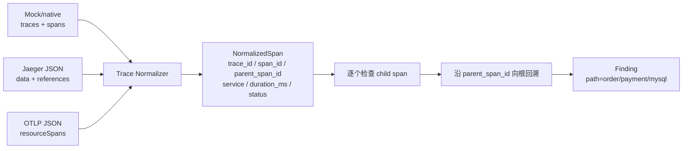

# OpsPilot Tool 面试速查表

> 面向实习面试，基于当前 Runtime v4 源码。详细数据流见 `docs/RCA_DATAFLOW_REFERENCE.md`。本文不把 Tool、分析器和 Expert 混为一谈。

## 1. 先记住三个概念

所有 Tool 的输入都是 `AlertToolInput(alert: AlertEvent)`，成功输出统一包装为：

```text
ToolResult.data.observations = {工具观察到的字段}
```

| 概念 | 通俗解释 | 例子 |
|---|---|---|
| `signal_key` | Tool 去哪个数据分类取信息，不是返回字段 | `db.replication` 从 `alert.signals["db"]` 或 DB Mock 接口取数据 |
| `observations` | Tool 实际返回给后续分析的字段 | `db.replication` 只返回复制延迟字段 |
| snapshot / HTTP | `alert.signals` 非空时，它就是完整快照；缺哪个分类就返回空，不再请求 HTTP。只有 `signals` 整体为空才请求 Mock HTTP | benchmark 主要走 snapshot，在线 Mock 主要走 HTTP |

源码：`src/opspilot/tools/registry.py: AlertToolInput, ObservationOutput, ObservationProvider.read`。

## 2. General Tools：通用初查

权限缩写：**Seed**＝Coordinator 首轮；**Planner**＝后续 Adaptive Planner。Planner 只能选择尚未执行的 General Tool。

| Tool / 权限 | 为什么查、何时选择 | 面试要记的返回字段 | Finding / Evidence 与阈值 | 失败影响 |
|---|---|---|---|---|
| `metrics.query`<br/>general<br/>Seed、Planner | 所有告警默认 Seed；判断流量、错误率、延迟和资源是否异常。timeout/error_rate 映射 upstream，resource/custom 映射 cluster | `qps`, `error_rate`, `tp99/tp95`, `cpu_usage`, `memory_usage` 及 series/baseline | QPS 末点低于前段均值 50%→`upstream_qps_drop`；error≥5%→`upstream_error_rate`；CPU/内存≥85%→high Finding/raw Evidence；还输入五种确定性算法 | 记为 ERROR，L1/算法忽略该结果；仍占一次 Tool 预算，调查可继续 |
| `logs.query`<br/>general<br/>Seed、Planner | error_rate/resource 默认 Seed；P0 会优先插入；证据不足时 fallback 可补查 | `logs` 或 `messages`，其中的 message 文本 | 含 `OutOfMemory`/`OOMKilled`→`oom_signature` + `log.oom`，confidence .95；其他非空日志只产 `error_pattern`，不直接转 Evidence | 同上；最终报告 `degraded=true` 并列入 `missing_sources` |
| `changes.query`<br/>general<br/>Seed、Planner | timeout/custom 默认 Seed；label 含 deploy/release/version/config 时前置；Planner 看到变更线索也优先补查 | `recent_deployment`, `changes`, `high_risk_count` | 任一近期变更→`recent_change`；raw `change.recent_deployment` 只在 recent=true 或 high_risk≥1 时生成；confidence .85 | 同上 |
| `traces.query`<br/>general<br/>Seed、Planner | timeout/error_rate 默认 Seed；label 含 dependency/downstream/trace/rpc 时前置；找异常下游及完整调用路径 | Mock/Jaeger/OTLP spans：`trace_id`, `span_id`, `parent_span_id`, service, duration, status；也可有聚合 RPC 字段 | child span 错误状态→`downstream_span_error`；`SLOW` 或 duration>1000ms→`downstream_span_slow`，confidence .9；聚合 timeout≥5%、latency ratio≥3 或 error≥5% 可产 RPC raw Evidence | 同上；失败时没有 trace path，但 Planner 可改查 Expert/其他 Tool |
| `topology.query`<br/>general<br/>Planner | deterministic fallback 只在 timeout/error_rate 证据不足时补查；LLM 也可从白名单选择 | `upstream` 等依赖拓扑，provider 原样返回 | 当前只进入 L1 upstream 上下文；**不产生 Finding，也无 raw Evidence** | 同上；当前对最终排名没有直接影响 |
| `alerts.query`<br/>general<br/>Planner | deterministic fallback 只在 P0/P1 证据不足时补查；用于关联历史告警/已知问题 | `related_alerts`/`alerts`, `known_issues` | 条目非空→`related_incident`，confidence `min(.5+数量×.1,.9)`；当前不转 Evidence | 同上；失败不会中断主流程 |

Seed 默认映射：

| alert_type | 首轮 Tools |
|---|---|
| `timeout` | metrics + traces + changes |
| `error_rate` | metrics + logs + traces |
| `resource` | metrics + logs |
| `custom` | metrics + logs + changes |

Seed 最终去重并最多保留 3 个 Tool。源码：`src/opspilot/agents/coordinator.py: SEED_TOOLS, CoordinatorAgent.plan, dimension_for_tool`。

## 3. Domain Tools：Expert 深挖

Adaptive Planner **不能直接调用这些 Tool**，只能先 `invoke_expert`；Expert 再按上下文选择自己的 Tool。权限由 `ActionValidator` 强制。

| Tool / 权限 | 为什么查、何时选择 | 面试要记的返回字段 | L2 Finding / Raw Evidence 与阈值 | 失败影响 |
|---|---|---|---|---|
| `db.replication`<br/>domain<br/>DB Expert | 查读副本/主从延迟；上下文含 replica/read/mysql 时选。若只有 timeout 且无线索，DB Expert 会与 slowlog 一起查 | `replication_lag_seconds`, `slave_delay_seconds` | lag≥5s→`db_replication_lag` + `db.replication_lag`；L2 confidence .9；lag≥15s 为 critical | DB Expert 仍完成，失败结果不产 Finding/Evidence；流程可继续 |
| `db.slowlog`<br/>domain<br/>DB Expert | 查慢 SQL；上下文含 slow/query/mysql/persistence 时选；普通 timeout 无更明确线索时也查 | `slow_query_count`, `slow_queries` | count≥10→`db_slow_query` + `db.slow_query`；L2 confidence .85；raw 在 count≥50 时 critical | 同上 |
| `db.connections`<br/>domain<br/>DB Expert | 查连接池耗尽；含 connection/queue/capacity/resource/storage/waiting 时选；resource 默认查它 | `active_connections`, `max_connections` | active/max≥80%→`db_connection_exhausted` + `db.connection_usage`，confidence .9；raw ≥95% critical | 同上 |
| `redis.memory`<br/>domain<br/>Redis Expert | 查缓存内存压力；含 memory/capacity/resource 时选；没有更明确 Redis 线索时默认查它 | `memory_usage_percent`, `used_memory`, `evicted_keys` | memory≥80%→`redis_memory_pressure` + `redis.memory_usage`，confidence .9；raw ≥95% critical | 同上 |
| `redis.hotkeys`<br/>domain<br/>Redis Expert | 查低命中率/热点问题；含 hit/hotkey/fallback/backend load 时选 | `hit_rate_percent`/`hit_rate`, `hotkeys` | hit rate≤90%→`redis_low_hit_rate` + `redis.hit_rate`，confidence .85；raw <70% critical | 同上 |
| `kafka.lag`<br/>domain<br/>Kafka Expert | 查消费者是否跟不上；Planner 文本命中 kafka/consumer/message/queue/event 等，或 alert_type 默认顺序选到 Kafka | `consumer_lag`/`total_lag`, `produce_rate`, `consume_rate` | lag≥1000→`kafka_consumer_lag` + `kafka.consumer_lag`，L2 confidence .9；raw ≥10000 critical | 同上 |
| `rpc.metrics`<br/>domain<br/>RPC Expert | 查依赖超时、错误和延迟；Planner 命中 rpc/grpc/dependency/downstream/payment/http，timeout/error_rate 默认优先 RPC | `timeout_rate`, `error_rate`, `latency_ms`, `baseline_latency_ms`, `call_volume` | timeout≥5%或 latency/baseline≥3→`rpc_timeout` (.9)；error≥5%→`rpc_error_rate` (.85)；同时生成 raw RPC Evidence | 同上 |

Expert 选择顺序还受告警类型影响：timeout 默认 `rpc→db`；error_rate 默认 `rpc→redis→kafka→db`；resource 默认 `db→redis→kafka`；custom 默认 `kafka→db→redis→rpc`。关键字匹配优先于默认顺序。源码：`src/opspilot/investigation/planner.py: DOMAIN_HINTS, DeterministicPlannerFallback._next_domain, LLMAdaptivePlanner.expert_tools`。

## 4. Compatibility Tools：为什么不能调度却还保留

| 旧 Tool | 旧职责 | 当前状态 |
|---|---|---|
| `db.inspect` | 一次返回全部 DB 观察 | Registry 可直接执行，collector/L2 仍能解析；Adaptive 主链不会选择 |
| `redis.inspect` | 一次返回全部 Redis 观察 | 同上 |
| `kafka.inspect` | 一次返回全部 Kafka 观察 | 同上 |
| `rpc.inspect` | 一次返回全部 RPC 观察 | 同上 |

它们是旧接口适配层，用于兼容旧 benchmark、测试和直接调用方。新架构把大工具拆成更具体的 Domain Tool，让 Expert 只查需要的数据。

“不能调用”准确含义是：Seed 只允许 `general_names()`，Planner 只能选择 General Tool 或 Expert，Expert 只允许自己 domain 的新 Tool；因此 **Adaptive 调度链不会调用 compatibility Tool**。它们并非从 Registry 消失，迁移完旧调用后才适合删除。源码：`src/opspilot/tools/registry.py: ToolRegistry.general_names, domain_names, build_default_registry`；`src/opspilot/investigation/planner.py: ActionValidator`。

## 5. Tool、L1 Analyzer、L2 Expert 的区别

| 角色 | 做什么 | 会不会访问外部数据 | 输入 → 输出 |
|---|---|---:|---|
| Tool | 负责“取数据”，不负责下根因结论 | 会 | `AlertEvent → ToolResult.observations` |
| L1 Analyzer | 对通用 ToolResult 做六维初判：change/upstream/downstream/cluster/errorlog/problem | 不会 | `ToolResult[] → DiagnosticFinding[]` |
| L2 Expert | 面向 DB/Redis/Kafka/RPC 深挖；先决定本领域要用哪些 Domain Tool，再解释结果 | Expert 本身通过受控 Tool 取数 | `上下文 → Domain Tool 子集 → L2 Finding[]` |

一句话回答：**Tool 是传感器，L1 是通用分诊，L2 Expert 是专科检查。** Finding 之后再转换为 Evidence，进入统一确定性排序。

## 6. Trace Tool：三种格式怎样变成完整路径



| 格式 | 关键适配 |
|---|---|
| Mock/native | 接受 snake_case/camelCase；旧 Mock 没有 ID 时，把后续匿名 span 挂到第一个匿名 root |
| Jaeger | `traceID/spanID`；从 `CHILD_OF` reference 取 parent；process 取 service；duration 微秒除以 1000 |
| OTLP JSON | 遍历 `resourceSpans → scopeSpans → spans`；resource attribute 取 `service.name`；纳秒时间差转毫秒 |

归一化后只检查有 parent 的 child span。错误状态集合是 `ERROR/FAILED/TIMEOUT/CANCELLED/ABORTED`；慢调用是状态 `SLOW` 或耗时 `>1000ms`。路径算法从异常 span 沿 `parent_span_id` 回溯，再反转得到根服务到异常服务；用 visited 集合避免坏数据形成死循环。源码：`src/opspilot/tracing/normalizer.py: normalize_trace_payload, _service_path, detect_span_anomalies`。

## 7. Tool 失败后的统一处理

```text
Tool timeout / provider exception
→ ToolExecutor 归一化为 ToolResult(status=error)
→ 可重试错误按 max_attempts 重试
→ 失败结果仍保存并计入 executed_tools
→ L1/L2/Evidence Collector 忽略失败结果
→ 使用剩余证据继续 Ranking、Gate 和下一轮调查
→ 最终 DiagnosisReport: degraded=true, missing_sources=[失败 Tool]
```

- 当前 Worker 默认外层 Tool timeout 为 `.2s`、最多 2 attempts。
- `ToolTimeoutError`、显式 `ToolExecutionError` 可重试；普通 provider `RuntimeError` 不带 retryable 标记，会直接返回失败。
- “成功但 observations 为空”不是 Tool 失败，只表示本数据源没观察到内容。
- 稳定 `tool_call_id` 让 Worker 恢复时复用已经成功的 Tool；失败执行则允许再次尝试。

源码：`src/opspilot/tools/executor.py: ToolExecutor.execute`、`src/opspilot/tools/errors.py`、`src/opspilot/config/settings.py: RuntimeSettings`、`src/opspilot/runtime/execution.py: RecoverableExecution._execute_tool`。

## 8. 面试要掌握到什么深度

### P0：必须记住

1. 6 个 General Tool、4 个 Expert 与 7 个 Domain Tool 分别解决什么问题。
2. `AlertEvent → ToolResult.observations → Finding → Evidence → Ranking` 主链。
3. Planner 不能直接调用 Domain Tool：只能 `inspect_tool(general)` 或 `invoke_expert(domain)`，由 `ActionValidator` 强制。
4. 关键阈值：资源 85%、DB 复制 5s、慢查询 10、连接 80%、Redis 内存 80%/命中率 90%、Kafka lag 1000、RPC 5%/延迟 3 倍、Span 1000ms。
5. Trace 先适配 Mock/Jaeger/OTLP，再用 `span_id/parent_span_id` 重建完整 path。
6. Tool 失败不会让整个 RCA 立即失败：错误归一化、有限重试、降级继续，报告标注 missing source。

### P1：知道即可

- 每个 Tool 的所有次要返回字段和 raw Evidence confidence 公式。
- P0/labels 如何调整 Seed 的具体插入顺序。
- Expert 的全部关键字列表和默认 domain 顺序。
- compatibility Tool 仍保留的迁移背景。
- Mock HTTP 的具体 URL、Jaeger/OTLP 每个字段的转换细节。

不需要背：稳定 ID 的 SHA256 拼接方式、每个 Pydantic 字段、所有 helper 实现。

## 9. 与旧 `docs/tools_intro.md` 的冲突

| 旧描述 | 当前代码事实 |
|---|---|
| “Runtime v3” | 当前配置是 `opspilot-runtime-v4-unified-evidence` |
| Planner 可 `finalize` | enum 仍有 `finalize`，但当前 `PlannerDecision` 和 `ActionValidator` 都拒绝；停止由 Evidence Gate/预算/无合法动作决定 |
| L3 算法在 finalize 后执行 | `DeterministicEvidenceEngine.analyze` 每轮都在 Gate 前基于累计 ToolResult 重算算法、Evidence 和 Ranking |
| topology 同时给 upstream/downstream | 当前 `_analysis_plan` 映射到 upstream；Analyzer 只读取其 upstream 上下文，而且不产 Finding |
| compatibility inspect Tool 属于当前动态调用链 | 当前 Adaptive Seed/Planner/Expert 均不会调度它们，只保留兼容执行与解析能力 |

当前行为依据：`src/opspilot/investigation/analysis.py: DeterministicEvidenceEngine.analyze`、`src/opspilot/investigation/engine.py: AdaptiveInvestigator.run`、`src/opspilot/investigation/planner.py: PlannerDecision, ActionValidator`。
