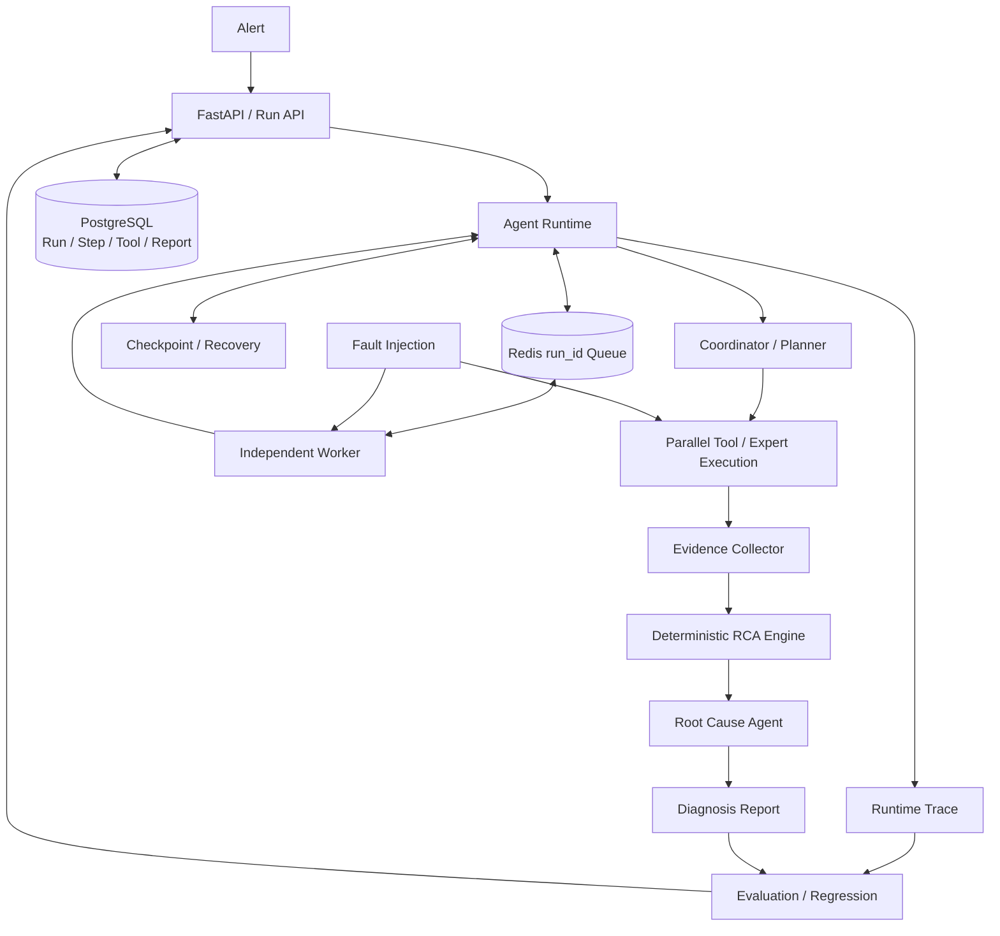

# OpsPilot 项目材料

本文是 OpsPilot 的招聘与面试主材料。所有“已验证”结论均以仓库代码和 `artifacts/` 中的工件为准；目标设计与尚未测量的能力会单独标注，不与实测结果混写。

## 1. 一句话定义

OpsPilot 是一个面向微服务故障诊断的可恢复 Agent RCA 平台：输入告警后异步规划并调用 Metrics、Logs、Changes、Trace、Topology 和领域工具，输出包含 Top-3 根因、置信度、Evidence 与建议的结构化报告。它与普通对话式 Agent 的区别是把工具执行、Run/Step 状态、Checkpoint、幂等和评测都变成可持久化、可恢复、可回归验证的工程契约。线上 Runtime 默认保留无外部依赖的确定性 fallback；离线 frozen test 已使用 DeepSeek 完成三路真实消融并记录 API Token。

## 2. 系统架构

各层职责如下：

- Alert / FastAPI：校验统一告警契约，以 `request_id` 创建或复用 Run，立即返回 `run_id`，不在 HTTP 请求内等待诊断完成。
- Agent Runtime / Worker：Redis 只传递 `run_id`；独立 Worker 从 PostgreSQL 读取事实状态，执行工作流并推进 Run 状态机。
- Coordinator / Planner：根据注册表生成可执行的只读工具计划；当前实现固定覆盖通用与 DB、Redis、Kafka、RPC 领域，计划本身不执行 I/O。
- Tool / Expert Execution：统一处理 schema 校验、超时、有限重试、执行记录与 `tool_call_id` 幂等；进程内评测路径使用 `asyncio.gather` 并发调用。
- Evidence / RCA / Root Cause：异构工具结果先转为稳定 Evidence，再按支持和反证加权产生候选；摘要器只解释证据驱动的候选，不负责凭空猜根因。
- PostgreSQL / Checkpoint / Trace：PostgreSQL 是 Run、Step、ToolExecution、Checkpoint、Report 和 RuntimeEvent 的唯一事实源；每个成功 Step 与 Checkpoint 原子提交。
- Evaluation / Fault Injection：固定数据集保存 ground truth 与 split，可靠性套件真实拉起独立 Worker 并注入崩溃、超时、HTTP 500 和重复请求/投递，逐 case、逐 trial 留存证据。

## 3. 一次完整请求的主链

1. 客户端向 `POST /api/v1/runs` 提交 `request_id + AlertEvent`；数据库唯一约束保证重复请求返回同一个 Run。
2. API 在 PostgreSQL 创建 `QUEUED` Run，仅把 `run_id` 放入 Redis 队列，然后返回 202。
3. Worker 取出 `run_id`，以条件状态迁移把 Run 从 `QUEUED` 推进到 `RUNNING`。
4. Planner 从 Tool Registry 生成 AnalysisPlan；计划和图版本写入首个 Checkpoint。
5. Runtime 依次跨越可恢复 Step；每个工具经统一 Executor 执行，结果和稳定 `tool_call_id` 持久化。进程内 Benchmark 路径可并发执行全组工具。
6. Evidence Collector 将 Metrics、Logs、Changes、Trace、Topology、DB、Redis、Kafka、RPC 结果标准化、去重和排序。
7. 确定性规则根据阈值、支持关系与反证生成 Top-3 候选；Root Cause Agent 生成简短 rationale 和处置建议。
8. Report、最终 Checkpoint 和 `SUCCEEDED` 状态写入 PostgreSQL；客户端通过状态、结果、事件或 WebSocket 接口读取。
9. 若 Tool 发生可重试错误，Executor 在预算内重试并记录每次 attempt；若 Worker 崩溃，Recovery Scanner 把 stale `RUNNING` Run 置为 `RETRYING -> QUEUED`，新 Worker 从最新成功 Checkpoint 后继续。

## 4. 十一个核心模块

### 4.1 Coordinator / Planner

**是什么：** 只负责制定分析计划的协调器。**作用：** 将告警转换为有顺序、带原因的 Tool Step，隔离“决定查什么”和“实际查询”。**怎么设计：** Planner 只读取 Alert 与 Registry 元数据，生成版本化 `AnalysisPlan`，不直接访问外部系统；当前计划覆盖 9 个只读工具。**为什么：** 纯函数式规划易做契约测试，也能在执行前校验未知工具并把计划写入 Checkpoint，避免恢复后重新产生不同计划。

### 4.2 Tool Registry / Tool Executor

**是什么：** 工具定义目录与唯一执行边界。**作用：** 把 Metrics、Logs、Changes、Trace、Topology 和领域查询统一成同一调用契约。**怎么设计：** Registry 保存名称、版本、输入/输出 schema、超时与最大 attempt；Executor 做 Pydantic 校验、超时、错误归一、有限重试和执行记录。**为什么：** Agent 不再直接调用 provider SDK，策略集中后更容易替换 Mock/真实后端，并能用稳定 ID 实现审计和幂等。

### 4.3 Evidence Pool

**是什么：** 工具观测到根因推理之间的事实层。**作用：** 把不同结构的数据转为 `source/type/fact/confidence/supports/contradicts` 一致的 Evidence。**怎么设计：** 以告警、来源、类型和事实生成稳定 ID，丢弃失败结果，按 ID 去重、按置信度排序；Evidence 只表达可观察事实，不把自然语言结论当标签。**为什么：** 这既约束模型幻觉，也让 Evidence Recall、反证和报告引用具有稳定评测主键。

### 4.4 RCA Engine

**是什么：** Evidence 到根因候选的确定性筛选层。**作用：** 用阈值、统计异常和专家规则先缩小搜索空间，再把结构化候选交给摘要层。**怎么设计：** DeepRCA 保留 IQR、波动检测、同比/环比、Noise Filter 与 Rule Engine；当前 OpsPilot frozen hybrid 实际走统一 Evidence 转换与支持/反证加权，尚未把全部旧算法接回在线 Runtime。**为什么：** 明确区分“已有算法资产”与“当前已测链路”，才能避免把 LLM 猜测或未接线代码包装成实验贡献。

### 4.5 Root Cause Agent

**是什么：** 对 Evidence 支持的候选做排序、解释和报告组装的最终诊断模块。**作用：** 输出 Top-3、置信度、证据 ID、rationale 与建议。**怎么设计：** 候选分数由 Evidence 的 supports/contradicts 决定；线上 Runtime 的摘要器可注入且默认使用 `FakeSummarizer` fallback，离线消融由独立 DeepSeek adapter 读取同一候选。**为什么：** 把“决定根因”和“自然语言表达”分离，模型失败不会抹掉已完成诊断，自动测试也不会意外访问付费 API。

### 4.6 Runtime / Worker

**是什么：** 将 HTTP 生命周期与长任务执行解耦的异步运行层。**作用：** API 快速受理，独立 Worker 领取并推进持久化 Run。**怎么设计：** FastAPI 仅创建 Run 和 enqueue；Redis 传递 `run_id`；Worker 每次从 PostgreSQL 重建上下文，通过受约束状态迁移执行；终态 Run 不会被重复消息再次执行。**为什么：** 进程内 background task 无法抵御 API/Worker 重启，而轻量队列加数据库事实源足以验证 MVP 的恢复和重复投递语义。

### 4.7 Checkpoint & Recovery

**是什么：** Step 边界的持久状态快照与 stale Run 扫描机制。**作用：** Worker 中断后跳过完整成功的步骤，从最后 Checkpoint 后继续。**怎么设计：** Step 输出与 Checkpoint 在同一事务提交，并携带 schema/graph version；Scanner 将 stale `RUNNING` 标为 `RETRYING`，重新入队；版本不兼容直接失败。**为什么：** 原子边界避免“Step 成功但快照丢失”，显式版本避免用新代码误读旧状态，也无需第一版就引入 Lease/Heartbeat。

### 4.8 Idempotency & Retry

**是什么：** 针对入口、队列和工具三层重复的防重与有限重试策略。**作用：** 网络重试不创建第二个 Run，消息重复不重跑终态任务，恢复不重复产生成功工具记录。**怎么设计：** `request_id` 受数据库唯一约束；`tool_call_id = hash(run + step + tool + version + normalized_args)`；成功 ToolExecution 可复用；只对 timeout/5xx 等 retryable 错误按预算重试。**为什么：** 至少一次投递环境无法消除重复，只能让重复操作收敛到同一事实。

### 4.9 Trace

**是什么：** 按 Run 单调序号保存的 RuntimeEvent 事件流。**作用：** 重建 `run.created -> step.started -> tool.* -> checkpoint.saved -> run.succeeded` 的执行时间线，并为 WebSocket、故障判定和审计提供统一来源。**怎么设计：** 事件与状态变更在 Repository 内写入 PostgreSQL，详情只保留工具 ID、attempt、错误码等简短事实，不保存私有思维链。**为什么：** 日志可能散落或丢失，结构化事件能直接支撑恢复延迟、重复成功执行数和回归定位。

### 4.10 Evaluation & Regression

**是什么：** 固定数据、配置、指标和工件格式的离线验证链。**作用：** 同一 split 比较系统，保留逐 case prediction、聚合 metrics、失败分类与复现 manifest。**怎么设计：** `EvaluationCase` 明确 root cause、Evidence、Tool ground truth；runner 不把标签传给系统；修复过的运行时失败进入 executable regression test，CI 重跑 dev，frozen test 保持不可变。**为什么：** 单个 Demo 无法证明稳定性，保留分子/分母和失败 case 才能防止挑样本或手填结果。

### 4.11 Fault Injection

**是什么：** 在真实 PostgreSQL、Redis 和独立 Worker 子进程上执行的可靠性测试套件。**作用：** 主动制造 WorkerCrash、ToolTimeout、ToolHTTP500、DuplicateRequest、DuplicateDelivery。**怎么设计：** YAML 固定注入点与轮数，Worker 崩溃使用退出码 97，工具故障由环境变量控制，8 路重复请求并发提交；每个 trial 保存完整 RuntimeEvent。**为什么：** 单元 Mock 不能证明进程死亡后的状态仍可恢复，真实进程和事实库让成功率、延迟与重复执行率具有可追溯含义。

## 5. 三个技术亮点：面试故事

### 5.1 确定性分析约束模型边界

直接把原始监控数据塞给 LLM，会把噪声、数值计算、因果判断和文本表达混在一起：输入不可控，结论难复现，也无法定义 Evidence Recall。项目因此把流程拆成“工具观测 -> 异常/规则 -> Evidence -> 候选 -> 摘要”。DeepRCA 中的 IQR 判断离群点，Volatility 检测滚动波动，Noise Filter 去除低影响抖动，Rule Engine 用领域规则提升或直接确定候选；OpsPilot 进一步冻结 Evidence schema，让候选只能引用证据 ID。

模型的合理职责是基于已筛选候选和证据生成解释、处理规则未覆盖的语义，而不是计算阈值或凭告警文本猜根因。三路 DeepSeek frozen test 严格隔离输入：LLM Only 只看公开告警、不看作为工具后端的隐藏 signals；LLM + Tools 看 9 个原始工具结果；Hybrid 再加入确定性 Evidence 与允许候选。结果从 4/10 提升到 10/10；相比 Tools，Hybrid 把 Evidence Recall 从 0 提到 1.0、FPR 从 1/2 降到 0/2，总 Token 从 6132 降至 5660（减少 7.7%），工具调用同为 108。这里的 Token 来自 DeepSeek API usage，不是字符估算。

### 5.2 可恢复 Agent Runtime

故障诊断会跨越多个工具与外部依赖，若只放在 FastAPI 的后台协程里，进程退出就无法知道完成到哪一步。OpsPilot 把 Run、Step、ToolExecution、Checkpoint、Report 和 RuntimeEvent 放入 PostgreSQL；Redis 只传 `run_id`。每个 Step 的输出与 Checkpoint 原子提交，恢复进程扫描 stale Run 并重新入队，新 Worker 读取最新快照，只执行未完成步骤。

完整实测案例是 `worker-crash-02`：原 Worker 已完成 plan、changes、metrics、logs、traces 与 db 的 Checkpoint，在进入 `tool:redis.inspect` 前以 97 退出；Scanner 写入 `run.recovered(RETRYING)`，随后同一 Run 回到 `QUEUED/RUNNING`，从 redis Step 继续，最终 `SUCCEEDED`。退出码为 `[97, 0, 0]`，恢复延迟 602.711 ms，9 个成功工具 ID 无重复。稳定 `request_id`、状态条件更新和 `tool_call_id` 分别覆盖 HTTP、队列与工具层重复。

### 5.3 让 RCA 能被评测和回归

数据集不是告警文本合集，而是版本化 `EvaluationCase`：包含固定 seed、fault/normal 标记、期望根因类型、期望 Evidence 类型和期望工具；dev 用于持续回归，test 冻结后只消费一次。Runner 对每个 case 保存系统原始 prediction，再用同一公式计算 Hit@1/3、Evidence Recall、Tool/E2E Success、FPR 与 P95，失败样本不从分母删除。

评测还覆盖 Planner 是否调用期望工具、Executor 是否成功、Evidence 是否命中、Root Cause 排名是否正确，以及 Runtime 故障后的合法终态。真实缺陷会固化为测试，例如重复 HTTP 请求曾放大 Redis 消息，修复后加入 `tests/regression/test_duplicate_request_queue.py`。这种链路把“Demo 看起来能跑”变成“同一配置可复现、失败可定位、修复可防回归”。

## 6. 实验与证据

### 6.1 实验 A：DeepSeek RCA 三路消融（已完成）

固定 `opspilot-rca@1.0.0` frozen test，12 case（10 fault、2 normal/noise）：

| 系统 | 输入与方法 | Hit@1 | Hit@3 | Evidence Recall | FPR | Tool Success / Calls | API Token | P95 |
|---|---|---:|---:|---:|---:|---:|---:|---:|
| LLM Only | 公开告警 -> DeepSeek | 4/10 | 4/10 | 0.0 | 0/2 | n/a / 0 | 4985 | 2200.236 ms |
| LLM + Tools | 公开告警 + 9 个原始 Tool 结果 -> DeepSeek | 10/10 | 10/10 | 0.0 | 1/2 | 108/108 | 6132 | 2400.149 ms |
| Algorithm + Rule + Tools + LLM | Tool -> 确定性 Evidence/候选 -> DeepSeek | 10/10 | 10/10 | 1.0 | 0/2 | 108/108 | 5660 | 2489.135 ms |

三组都使用 `deepseek-v4-flash`、temperature 0、thinking disabled 和同一 frozen split；每组 12 次 API 调用，E2E 均为 12/12。LLM + Tools 虽然根因命中，但没有稳定输出数据集定义的 Evidence type，并在一个 normal case 误报；Hybrid 用确定性 Evidence 约束后消除了这两个问题，且比 Tools 少 472 tokens。P95 是包含真实 DeepSeek 网络请求的进程内端到端延迟，不含 Runtime 队列和数据库。

证据：[LLM Only report](../artifacts/evaluations/20260816T083652Z-deepseek_llm_only-test/report.md)、[LLM + Tools report](../artifacts/evaluations/20260816T083936Z-deepseek_tools-test/report.md)、[Hybrid report](../artifacts/evaluations/20260816T083959Z-deepseek_hybrid-test/report.md)、[最终索引](../artifacts/stage3/final_evidence.json)。首轮 Tools/Hybrid 暴露的空响应与单候选 JSON 边界失败也保留在 `20260816T083718Z-*`、`20260816T083744Z-*`，修复后固化为 `tests/regression/test_deepseek_json_boundary.py`。

### 6.2 实验 B：Runtime Reliability（已完成）

真实 PostgreSQL 10.19、Redis 7.2.7 与独立 Worker 子进程，5 类故障各 3 轮：

| 故障 | 轮数 | 成功 | 关键语义 |
|---|---:|---:|---|
| WorkerCrash | 3 | 3/3 | 崩溃进程 97；Scanner + 新 Worker 续跑 |
| ToolTimeout | 3 | 3/3 | 每次注入 2 次失败，耗尽重试后生成 degraded report |
| ToolHTTP500 | 3 | 3/3 | 首次 500，有限重试后成功 |
| DuplicateRequest | 3 | 3/3 | 每轮并发提交 8 次，收敛到一个 Run |
| DuplicateDelivery | 3 | 3/3 | 每轮重复投递 2 次，终态 Run 不重跑 |

聚合结果：Recovery Success 15/15，E2E Success 15/15；132 条成功 ToolExecution 中重复成功数为 0，即实测重复成功执行率 0/132；3 个 WorkerCrash 的 P95 recovery 为 602.711 ms；全部 trial 的 P95 E2E 为 1571.484 ms。Retry attempt 没有聚合指标，不能从 `failure_count` 冒充 Retry Count；LLM Timeout 因冻结路径不调用外部 LLM，未注入。

证据：[reliability report](../artifacts/evaluations/20260812T061631Z-runtime-faults-v1/report.md)、[trials](../artifacts/evaluations/20260812T061631Z-runtime-faults-v1/trials.jsonl)、[worker-crash-02 timeline](../artifacts/evaluations/20260812T061631Z-runtime-faults-v1/trials/worker-crash-02.jsonl)。

### 6.3 实验 C：Sequential vs Parallel（已完成）

在同一 24-case dev 数据上，为每个工具固定注入 20 ms 异步 provider I/O，Sequential 与 Parallel 各运行 3 轮、每侧 72 个 Run。Sequential P50/P95 为 220.672/498.469 ms，Parallel 为 20.869/99.827 ms，P95 加速 4.993 倍；两侧 Tool Success 均为 648/648。实现通过显式 `execution_mode` 切换顺序 await 与 `asyncio.gather`，其余 Registry、工具、Evidence 和 RCA 链完全相同。

证据：[concurrency report](../artifacts/evaluations/20260816T084034Z-tool-concurrency-v1/report.md) 和 [144 条逐 Run 记录](../artifacts/evaluations/20260816T084034Z-tool-concurrency-v1/runs.jsonl)。这是受控调度实验，证明并行 I/O 行为，不代表生产网络延迟；可恢复 Runtime 仍按工具 Step 顺序提交 Checkpoint。

## 7. 典型案例：DB 连接池耗尽与中断恢复

业务诊断证据来自 frozen case `db-test-02`：`order-service` 出现资源类告警，输入观测为 active connections 170 / max connections 200。Planner 调用了 9 个工具；`db.inspect` 结果被转换为 `db.connection_usage` Evidence，确定性阈值判断连接使用率 85%，支持 `db_connection_exhausted`，其他工具未产生更强反证，最终 Top-1 命中 ground truth。该 prediction 共 9/9 工具成功，耗时 0.394 ms（进程内范围）。

如果 Worker 在同类 Run 的 `redis.inspect` 前崩溃，恢复路径已经由独立 reliability case 验证：Trace 中能看到 db Step 的 `tool.finished` 和 `checkpoint.saved`，随后是 `run.recovered -> QUEUED -> RUNNING`；新 Worker 从 redis Step 继续，先前的 db 工具不会重跑，最后写入 report 与 `run.succeeded`。业务 case 与 crash trial 是两条真实证据的组合说明，不声称它们来自同一次 trial。

该业务样本保存在 frozen dataset 与 prediction；重复请求放大队列的真实失败则固化为 `tests/regression/test_duplicate_request_queue.py`。因此 case、运行 Trace 和修复回归分别回答“诊断是否正确”“中断能否恢复”“同类缺陷会不会复发”。

证据：[case definition](../benchmarks/datasets/rca/v1/test.jsonl)、[hybrid predictions](../artifacts/evaluations/20260812T052914Z-opspilot_hybrid-test/predictions.jsonl)、[crash timeline](../artifacts/evaluations/20260812T061631Z-runtime-faults-v1/trials/worker-crash-02.jsonl)。

## 8. 最终简历项目描述

**OpsPilot｜面向微服务故障诊断的可恢复 Agent RCA 平台**

**技术栈：** Python、FastAPI、PostgreSQL、Redis、asyncio、Docker Compose、Pydantic、SQLAlchemy/Alembic（DeepRCA 兼容链路使用 LangGraph）

- 面向告警诊断长任务，将 FastAPI、Redis `run_id` 队列、独立 Worker 与 PostgreSQL 事实源解耦，构建 Planner -> 多源 Tool -> Evidence -> Root Cause -> Report 主链，支持 Top-3 根因及可追溯证据输出。
- 设计 DeepSeek 三路同集消融验证 Evidence 约束：LLM Only Hit@1 4/10，Tools 10/10 但 FPR 1/2、Evidence Recall 0；Hybrid 保持 10/10 并将 FPR 降至 0/2、Evidence Recall 提至 1.0，相比 Tools 减少 7.7% Token。
- 设计 Run/Step/Checkpoint 状态机、稳定 `request_id/tool_call_id` 和有限重试；真实 PostgreSQL/Redis/Worker 故障注入 15/15 恢复并端到端成功，132 条成功工具执行中重复数 0，Worker Crash P95 恢复 602.711 ms。
- 建立版本化 dataset/config、逐 case prediction、RuntimeEvent Trace 与 regression/CI 门禁；所有简历指标均可追溯到 `artifacts/stage3/final_evidence.json`，失败 case 不从评测分母删除。

## 9. 三分钟项目介绍

我做 OpsPilot，是因为普通 Agent Demo 往往只证明一次请求能跑通，但微服务故障诊断是长任务：要查指标、日志、变更和调用链，任何工具或 Worker 都可能中断，而且最后还要证明根因真的找对了。所以项目的目标不是堆更多 Agent，而是让 Agent 能调用工具完成 RCA，并且任务失败后能恢复、结果能评测。

整体上，告警先进入 FastAPI。API 用 request_id 在 PostgreSQL 创建 Run，只把 run_id 放进 Redis，然后立即返回；独立 Worker 读取 Run，Coordinator 生成工具计划，统一 Executor 调用 Metrics、Logs、Changes、Trace、Topology 和 DB/Redis/Kafka/RPC 工具。工具结果先转成 Evidence，再由确定性阈值和支持/反证规则产生 Top-3 候选，Root Cause Agent 负责解释并生成结构化报告。Run、Step、工具执行、Checkpoint、Report 和事件都落在 PostgreSQL，Redis 不承担事实存储。

我认为最大的亮点有三个。第一，根因不是让模型直接猜：三路 DeepSeek 实验中，LLM Only 只有 4/10，Tools 达到 10/10 但出现 1/2 normal 误报且 Evidence Recall 为 0；加入确定性 Evidence 约束后保持 10/10、FPR 变为 0/2、Evidence Recall 达到 1.0，总 Token 还减少 7.7%。第二，运行时每个 Step 与 Checkpoint 原子提交；Worker 崩溃后 Scanner 找到 stale Run，新 Worker 从最后快照继续，request_id 和 tool_call_id 分别解决入口与工具重复。第三，数据集固定 ground truth、dev/test split 和指标，每次保留 prediction、failure、manifest 与 Trace，真实缺陷会进入 regression。

结果上，12 个 frozen case 中，DeepSeek LLM Only Hit@1 是 4/10，Tools 与 Hybrid 都是 10/10；但只有 Hybrid 达到 Evidence Recall 1.0 和 FPR 0/2，并比 Tools 少 472 tokens。受控并发实验的 P95 从 498.469 ms 降到 99.827 ms。可靠性实验在真实 PostgreSQL、Redis 和独立 Worker 上跑了 5 类故障共 15 轮，Recovery 和 E2E 都是 15/15，132 条成功工具执行没有重复，Worker Crash P95 恢复 602.711 ms。

一个具体案例是 Worker 在完成 DB Checkpoint、准备执行 Redis 工具时以 97 退出。事件流保留了此前所有成功 Step；恢复扫描把 Run 从 RUNNING 推到 RETRYING 再入队，新 Worker 直接从 Redis Step 继续，最终成功报告，已经完成的 DB 查询没有重复。这个案例能把持久化、恢复、幂等、Trace 和评测串成一个闭环。

## 10. 十个高频追问

### 1. 为什么需要 Agent，而不是固定脚本？

RCA 的查询集合与顺序取决于告警类型、服务拓扑和已有证据，Planner + Tool 契约允许逐步扩展决策；但当前 MVP 的 Planner 有意保持确定性，先验证执行和恢复契约。Agent 价值在“可规划的工具编排与证据解释”，不是使用自由文本就自动成立。

### 2. 为什么不是纯 ReAct？

纯 ReAct 把规划、调用和推理交织在一段模型上下文中，恢复点和幂等键都不稳定。这里把 Plan、Step、ToolCall、Evidence 和 Report 结构化并持久化；模型即使失败，也不会抹掉工具结果。代价是自由度更低，但更适合需要审计和回归的 RCA。

### 3. Planner 如何工作？

它读取统一 Alert 和 Registry，输出带 step_id、tool_name、priority、reason 的 AnalysisPlan，不做 I/O。当前版本固定选择 9 个只读工具，这是为了冻结契约；下一步可以根据告警和证据裁剪工具，但必须用 Tool Recall、调用数和准确率共同验收。

### 4. 为什么需要 Tool？

告警描述通常只是现象，根因需要监控事实。Tool 把 Metrics、Logs、Changes、Trace、Topology 和领域数据带入系统；统一 Registry/Executor 又提供 schema、timeout、retry 和 execution record，使外部依赖不直接污染 Agent 控制流。

### 5. 为什么算法 + LLM，而不是只用一种？

数值异常、阈值和规则应由确定性代码处理，结果可复现且易评测；LLM 更适合对候选与证据做语义解释、覆盖规则外模式。真实 DeepSeek 三路消融表明：Tools 解决了无观测时的漏诊，确定性 Evidence 又解决了稳定证据标签和 normal 误报，并把 Tools 方案的总 Token 从 6132 降到 5660。线上仍保留 fake/deterministic fallback，自动测试不访问付费 API。

### 6. Evidence 如何定义？

Evidence 是带稳定 ID 的可观察事实，包含来源、类型、服务、时间、fact、severity、confidence，以及 supports/contradicts 的根因类型。它不是自由文本根因。这样报告可以引用证据，评测可以计算 Evidence Recall，反证也能降低候选分数。

### 7. Redis 和 PostgreSQL 如何分工？

Redis 只做低延迟 run_id 传递，消息可丢可重；PostgreSQL 保存全部事实和唯一约束。Worker 永远从数据库恢复上下文，终态和条件状态迁移阻止重复消息重跑；QUEUED 修复扫描弥补 DB commit 后 Redis enqueue 失败的窗口。

### 8. Checkpoint 如何恢复？

每个成功 Step 的输出和完整 state 在一个事务内写入，并记录 schema/graph version。Scanner 发现 stale RUNNING 后写入 recovered 事件、转 RETRYING、重新入队；新 Worker校验版本，读取 latest checkpoint，跳过已完成工具，从下一 Step 执行。

### 9. 幂等如何实现？

入口用 request_id 唯一约束决定只有创建者入队；队列消费者用状态条件更新，RUNNING/终态消息直接忽略；工具 ID 对 run、step、工具版本和规范化参数做 hash，已有成功 ToolExecution 直接复用。15-trial 实验中重复成功执行为 0/132。

### 10. Evaluation 如何证明系统有效？

它固定 dataset version、split、config 和 metric 公式，ground truth 不传给被测系统，并保留逐 case prediction 和 failure。当前证据证明 DeepSeek Hybrid 在这 12 个合成 frozen case 上比 LLM Only 更准、比 Tools 的 Evidence/FPR 更稳，也证明 15 次注入可恢复；它不证明生产泛化，受控并发结果也不能替代生产压测。

## 11. 数字证据映射与当前边界

| 简历数字 | 权威字段 | 工件 |
|---|---|---|
| baseline Hit@1/3 1/10 | `baseline.metrics.root_cause_hit_at_1/3` | [`final_evidence.json`](../artifacts/stage3/final_evidence.json) |
| hybrid Hit@1/3 10/10、Evidence 1.0、FPR 0/2 | `hybrid.metrics.*` | [`final_evidence.json`](../artifacts/stage3/final_evidence.json) |
| Tool Success 108/108 | `hybrid.metrics.tool_success_rate` | [`metrics.json`](../artifacts/evaluations/20260812T052914Z-opspilot_hybrid-test/metrics.json) |
| Runtime Recovery/E2E 15/15 | `runtime.metrics.*_success_rate` | [`final_evidence.json`](../artifacts/stage3/final_evidence.json) |
| 重复成功工具 0/132 | `runtime.metrics.duplicate_successful_tool_executions` | [`reliability.json`](../artifacts/evaluations/20260812T061631Z-runtime-faults-v1/reliability.json) |
| Worker Crash P95 602.711 ms | `runtime.metrics.p95_recovery_latency_ms` | [`final_evidence.json`](../artifacts/stage3/final_evidence.json) |
| DeepSeek 4/10 -> 10/10 | `deepseek_ablation.*.hit_at_1` | [`final_evidence.json`](../artifacts/stage3/final_evidence.json) |
| Hybrid 5660 Token、比 Tools 少 472 | `deepseek_ablation.*.total_tokens` | [`final_evidence.json`](../artifacts/stage3/final_evidence.json) |
| Parallel P95 99.827 ms、4.993x | `concurrency.parallel` / `p95_speedup` | [`final_evidence.json`](../artifacts/stage3/final_evidence.json) |

当前不得对外声称：真实生产流量准确率、LLM Timeout Runtime 恢复、Kubernetes 生产部署、自动修复或全量 DeepRCA IQR/Rule Engine 已接入 OpsPilot Runtime。DeepSeek 三路消融只适用于 12-case 合成 frozen test；4.993 倍并发收益只适用于固定 20 ms 工具 I/O 的受控实验；两者都不能外推为生产 SLA。
